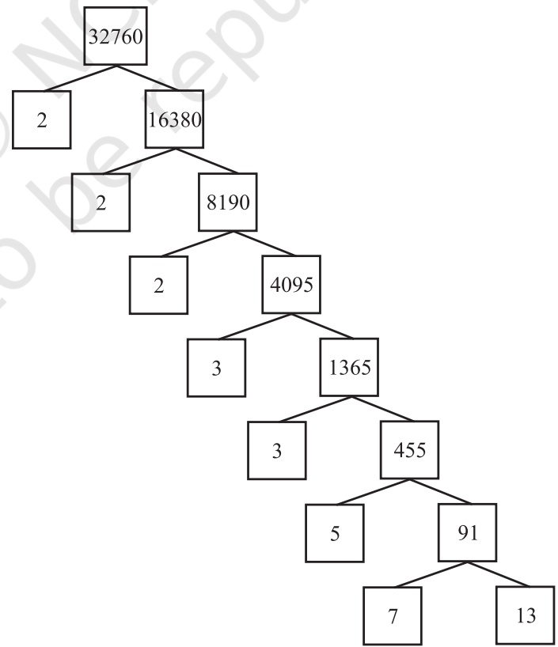

## 1.2 The Fundamental Theorem of Arithmetic

**In your earlier classes, you have seen that any natural number can be written as a product of its prime factors. For instance,** $2 = 2, 4 = 2 \times 2, 253 = 11 \times 23,$ **, and so on. Now, let us try and look at natural numbers from the other direction. That is, can any natural number be obtained by multiplying prime numbers? Let us see.**

**Take any collection of prime numbers, say 2, 3, 7, 11 and 23. If we multiply some or all of these numbers, allowing them to repeat as many times as we wish, we can produce a large collection of positive integers (In fact, infinitely many). Let us list a few :**

$$
7 \times 1 1 \times 2 3 = 1 7 7 1
$$

$$
3 \times 7 \times 1 1 \times 2 3 = 5 3 1 3
$$

$$
2 \times 3 \times 7 \times 11 \times 23 = 10626
$$

$$
2 ^ { 3 } \times 3 \times 7 ^ { 3 } = 8 2 3 2
$$

$$
2^{2} \times 3 \times 7 \times 11 \times 23 = 21252
$$

**and so on.**

**Now, let us suppose your collection of primes includes all the possible primes. What is your guess about the size of this collection? Does it contain only a finite number of integers, or infinitely many? Infact, there are infinitely many primes. So, if we combine all these primes in all possible ways, we will get an infinite**

**collection of numbers, all the primes and all possible products of primes. The question is – can we produce all the composite numbers this way? What do you think? Do you think that there may be a composite number which is not the product of powers of primes? Before we answer this, let us factorise positive integers, that is, do the opposite of what we have done so far.**

**We are going to use the factor tree with which you are all familiar. Let us take some large number, say, 32760, and factorise it as shown.**

