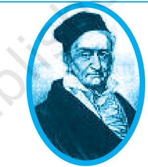

**So we have factorised 32760 as** $2 \times 2 \times 2 \times 3 \times 3 \times 5 \times 7 \times 1 3$ **as a product of** primes, i.e., $32760 = 2^{3} \times 3^{2} \times 5 \times 7 \times 13$ **as a product of powers of primes. Let us try** another number, say, 123456789. This can be written as $3 ^ { 2 } \times 3 8 0 3 \times 3 6 0 7$ **. Of course, you have to check that 3803 and 3607 are primes! (Try it out for several other natural numbers yourself.) This leads us to a conjecture that every composite number can be written as the product of powers of primes. In fact, this statement is true, and is called the Fundamental Theorem of Arithmetic because of its basic crucial importance to the study of integers. Let us now formally state this theorem.**

**Theorem 1.1 (Fundamental Theorem of Arithmetic) :** Every composite number can be expressed (factorised) as a product of primes, and this factorisation is unique, apart from the order in which the prime factors occur.

**An equivalent version of Theorem 1.2 was probably first recorded as Proposition 14 of Book IX in Euclid’s Elements, before it came to be known as the Fundamental Theorem of Arithmetic. However, the first correct proof was given by Carl Friedrich Gauss in his** Disquisitiones Arithmeticae.

**Carl Friedrich Gauss is often referred to as the ‘Prince of Mathematicians’ and is considered one of the three greatest mathematicians of all time, along with Archimedes and Newton. He has made fundamental contributions to both mathematics and science.**

Carl Friedrich Gauss (1777 – 1855)

**The Fundamental Theorem of Arithmetic says that every composite number can be factorised as a product of primes. Actually it says more. It says that given any** composite number it can be factorised as a product of prime numbers in a ‘unique **way, except for the order in which the primes occur. That is, given any composite number there is one and only one way to write it as a product of primes, as long as we are not particular about the order in which the primes occur. So, for example, we regard** $2 \times 3 \times 5 \times 7$ **as the same as** $3 \times 5 \times 7 \times 2$ **, or any other possible order in which these primes are written. This fact is also stated in the following form:**

The prime factorisation of a natural number is unique, except for the order of its factors.