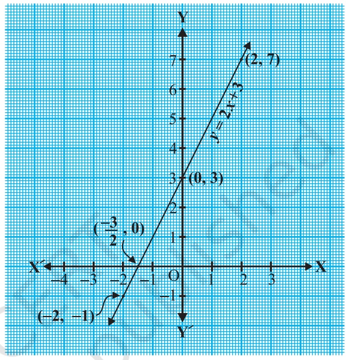

Consider first a linear polynomial $ax + b, a \neq 0$ . You have studied in Class IX that the graph of $y = a x + b$ is a straight line. For example, the graph of $y = 2 x + 3$ is a straight line passing through the points $( - 2 , - 1 )$ and (2, 7).

| x | -2 | 2 |
| --- | --- | --- |
| y = 2x + 3 | -1 | 7 |

From Fig. 2.1, you can see that the graph of $y \; = \; 2x \; + \; 3$ intersects the x - axis mid-way between $x   =   - 1$ and $x   =   - 2$ that is, at the point $\left( - \frac { 3 } { 2 } , 0 \right)$ You also know that the zero of $2x + 3   is   -\frac{3}{2}$ . Thus, the zero of the polynomial $2 x \; + \; 3$ is the x-coordinate of the point where the graph of $y = 2x + 3$ intersects the x-axis.

Fig. 2.1

In general, for a linear polynomial $ax + b,   a \neq 0$ , the graph of $y = a x + b$ is a straight line which intersects the x-axis at exactly one point, namely, $\left( { \frac { - b } { a } } , 0 \right)$ Therefore, the linear polynomial $ax + b,   a \neq 0$ , has exactly one zero, namely, the x-coordinate of the point where the graph of $y = a x + b$ intersects the x-axis.

Now, let us look for the geometrical meaning of a zero of a quadratic polynomial. Consider the quadratic polynomial $x ^ { 2 }   -   3 x   -   4$ . Let us see what the graph\* of $y = x ^ { 2 } - 3 x - 4$ looks like. Let us list a few values of $y = x ^ { 2 } - 3 x - 4$ corresponding to a few values for x as given in Table 2.1.

<small>\* Plotting of graphs of quadratic or cubic polynomials is not meant to be done by the students, nor is to be evaluated.</small>