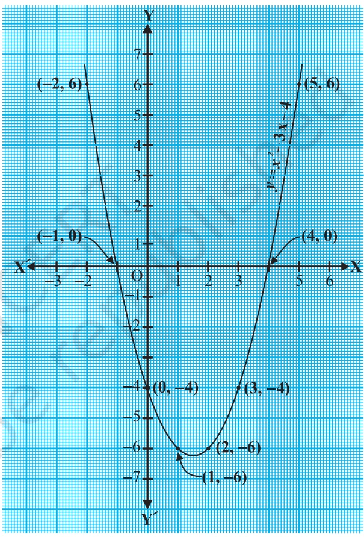

Table 2.1

| x | - 2 | -1 | 0 | 1 | 2 | 3 | 4 | 5 |
| --- | --- | --- | --- | --- | --- | --- | --- | --- |
| y = x2 - 3x - 4 | 6 | 0 | - 4 | - 6 | - 6 | - 4 | 0 | 6 |

If we locate the points listed above on a graph paper and draw the graph, it will actually look like the one given in Fig. 2.2.

In fact, for any quadratic polynomial $ax^{2}+bx+c,a\ne 0$ , the graph of the corresponding equation $y = a x ^ { 2 } + b x + c$ has one of the two shapes either open upwards like or open downwards like $\triangle$ depending on whether $a > 0$ or $a < 0$ . (These curves are called **parabolas**.)

You can see from Table 2.1 that –1 and 4 are zeroes of the quadratic polynomial. Also note from Fig. 2.2 that –1 and 4 are the x-coordinates of the points where the graph of $y = x ^ { 2 } - 3 x - { \overline { { 4 } } }$ intersects the x- axis. Thus, the zeroes of the quadratic polynomial $x ^ { 2 } - 3 x - 4$ are x-coordinates of the points where the graph of $y = x^{2} - 3x - 4$ intersects the x-axis.

Fig. 2.2

This fact is true for any quadratic polynomial, i.e., the zeroes of a quadratic polynomial $ax^{2}+bx+c,a\ne 0$ , are precisely the x-coordinates of the points where the parabola representing $y = a x ^ { 2 } + b x + c$ intersects the $x - \mathrm { a x i s }$

From our observation earlier about the shape of the graph of $y = a x ^ { 2 } + b x + c .$ , the following three cases can happen: