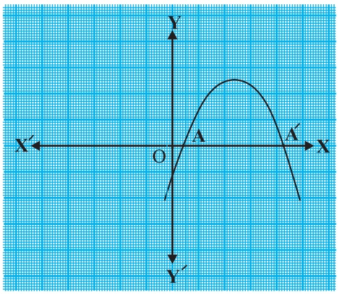
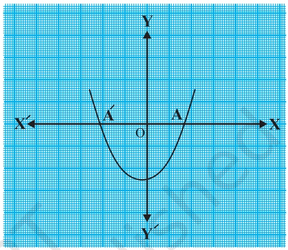
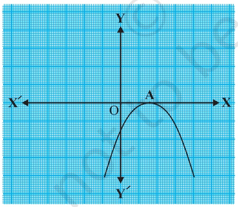
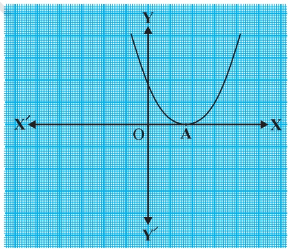

**Case (i) :** Here, the graph cuts x-axis at two distinct points A and A .

The x-coordinates of A and A  are the **two zeroes** of the quadratic polynomial $a x ^ { 2 } + b x + c$ in this case (see Fig. 2.3).

(i)

(ii)

Fig. 2.3

Case (ii) : Here, the graph cuts the x-axis at exactly one point, i.e., at two coincident points. So, the two points A and A  of Case (i) coincide here to become one point A (see Fig. 2.4).

(i)

(ii)

Fig. 2.4

The x-coordinate of A is the only zero for the quadratic polynomial $a x ^ { 2 } + b x + c$ in this case.