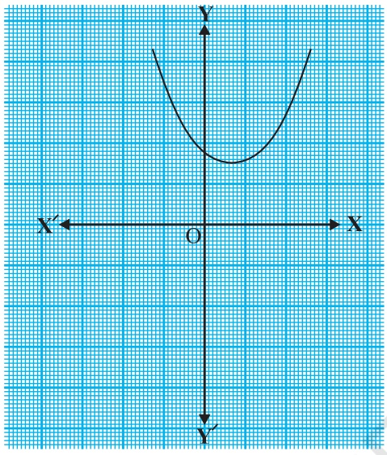
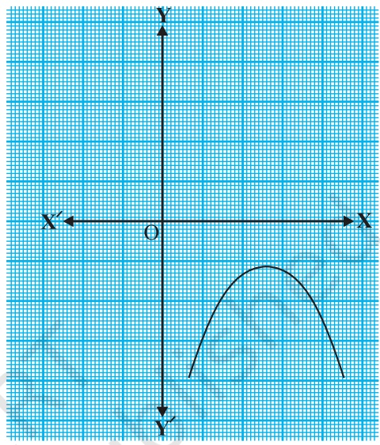

**Case (iii) :** Here, the graph is either completely above the x-axis or completely below the x-axis. So, it does not cut the x-axis at any point (see Fig. 2.5).

(i)

(ii)

Fig. 2.5

So, the quadratic polynomial $ax^{2} + bx + c$ has **no zero** in this case.

So, you can see geometrically that a quadratic polynomial can have either two distinct zeroes or two equal zeroes (i.e., one zero), or no zero. This also means that a polynomial of degree 2 has atmost two zeroes.

Now, what do you expect the geometrical meaning of the zeroes of a cubic polynomial to be? Let us find out. Consider the cubic polynomial $x ^ { 3 } - 4 x .$ . To see what the graph of $y = x ^ { 3 } - 4 \underline { { x } }$ looks like, let us list a few values of y corresponding to a few values for x as shown in Table 2.2.

Table 2.2

| x | -2 | -1 | 0 | 1 | 2 |
| --- | --- | --- | --- | --- | --- |
| y = x3 - 4x | 0 | 3 | 0 | -3 | 0 |

Locating the points of the table on a graph paper and drawing the graph, we see that the graph of $y = x ^ { 3 } - 4 x$ actually looks like the one given in Fig. 2.6.