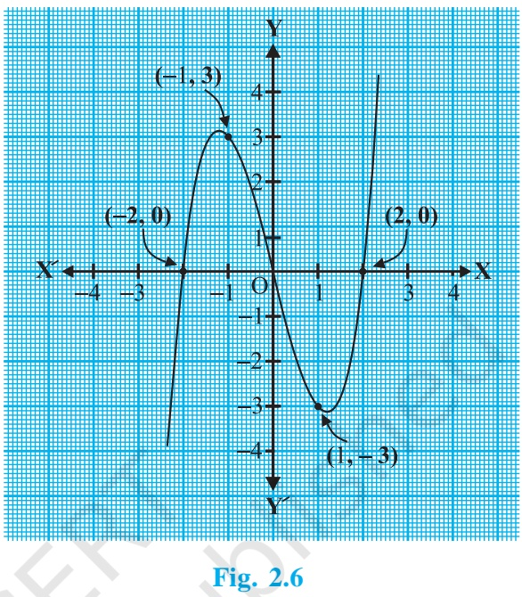
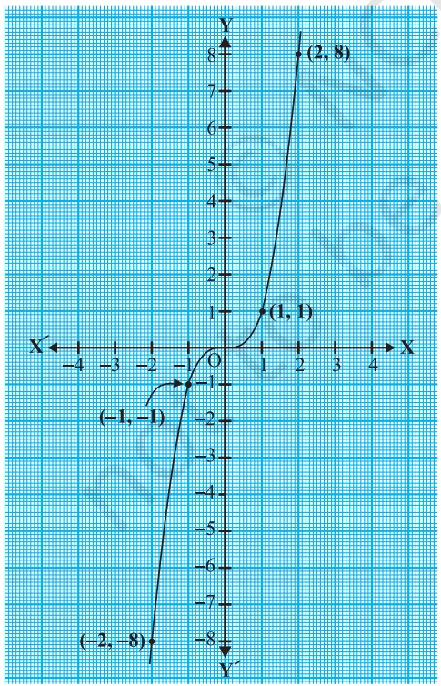
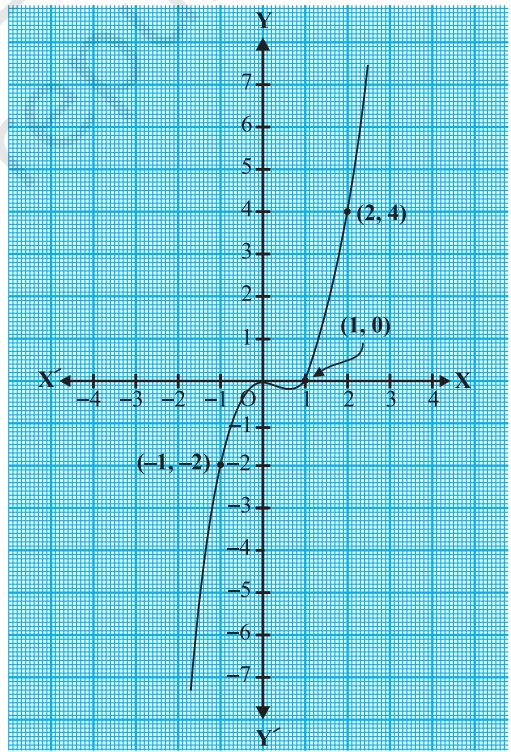

We see from the table above that – 2, 0 and 2 are zeroes of the cubic polynomial $x ^ { 3 } - 4 x .$ Observe that – 2, 0 and 2 are, in fact, the x-coordinates of the only points where the graph of $y   =   x ^ { 3 }   -   4 x$ intersects the x-axis. Since the curve meets the x-axis in only these 3 points, their x - coordinates are the only zeroes of the polynomial.

Let us take a few more examples. Consider the cubic polynomials $x ^ { 3 }$ and $x ^ { 3 }   -   x ^ { 2 }$ . We draw the graphs of $y = x ^ { 3 }$ and $y = x ^ { 3 } - x ^ { 2 }$ in Fig. 2.7 and Fig. 2.8 respectively.

Fig. 2.7

Fig. 2.8