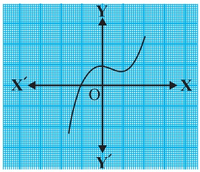
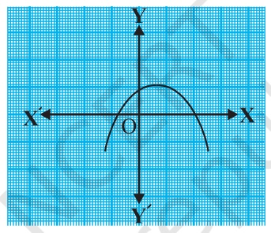
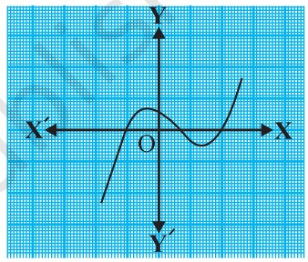
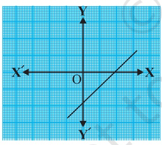
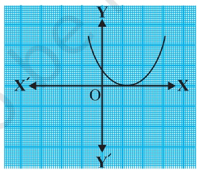
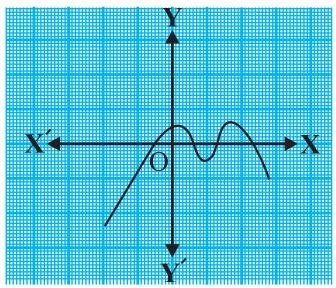

Note that 0 is the only zero of the polynomial $x ^ { 3 }$ . Also, from Fig. 2.7, you can see that 0 is the x-coordinate of the only point where the graph of $y = x ^ { 3 }$ intersects the x-axis. Similarly, since $x^{3}-x^{2}=x^{2}(x-1)$ , 0 and 1 are the only zeroes of the polynomial $x ^ { 3 } - x ^ { 2 }$ . Also, from Fig. 2.8, these values are the x - coordinates of the only points where the graph of $y = x ^ { 3 } - x ^ { 2 }$ intersects the x-axis.

From the examples above, we see that there are at most 3 zeroes for any cubic polynomial. In other words, any polynomial of degree 3 can have at most three zeroes.

**Remark :** In general, given a polynomial $p ( x )$ of degree n, the graph of $y = p ( x )$ intersects the x-axis at atmost n points. Therefore, a polynomial $p ( x )$ of degree n has at most n zeroes.

**Example 1 :** Look at the graphs in Fig. 2.9 given below. Each is the graph of ${ \overline { { y } } } \equiv { \overline { { p } } } ( x )$ where $p ( x )$ is a polynomial. For each of the graphs, find the number of zeroes of $p ( x )$

(i)

(ii)

(iv)

(v)

Fig. 2.9

(iii)

(vi)

## Solution :

(i) The number of zeroes is 1 as the graph intersects the x-axis at one point only.

(ii) The number of zeroes is 2 as the graph intersects the x-axis at two points.

(iii) The number of zeroes is 3. (Why?)