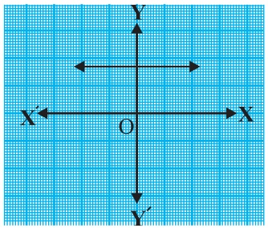
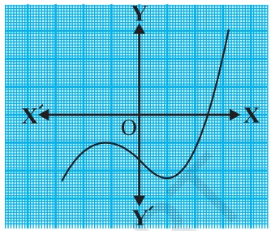
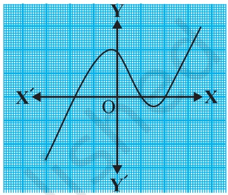
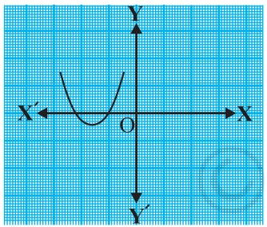
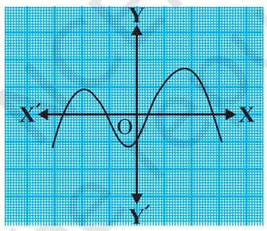
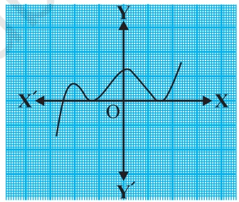

(iv) The number of zeroes is 1. (Why?)

(v) The number of zeroes is 1. (Why?)

(vi) The number of zeroes is 4. (Why?)

## EXERCISE 2.1

**1.** The graphs of $y = p ( x )$ are given in Fig. 2.10 below, for some polynomials $p ( x )$ . Find the number of zeroes of $p ( x )$ , in each case.

(i)

(ii)

(iii)

(iv)

(v)

Fig. 2.10

(vi)

## 2.3 Relationship between Zeroes and Coefficients of a Polynomial

You have already seen that zero of a linear polynomial $a x   +   b   \mathrm { i s }   -   { \frac { b } { - } }$ . We will now try to answer the question raised in Section 2.1 regarding the relationship between zeroes and coefficients of a quadratic polynomial. For this, let us take a quadratic polynomial, say $p ( x ) = 2 x ^ { 2 } - 8 x + 6 .$ . In Class IX, you have learnt how to factorise quadratic polynomials by splitting the middle term. So, here we need to split the middle term $- 8 x$ as a sum of two terms, whose product is $6 \times 2 x ^ { 2 } = 1 2 x ^ { 2 }$ . So, we write

$$
\begin{aligned}2x^{2}-8x+6&=2x^{2}-6x-2x+6=2x(x-3)-2(x-3)\\&=(2x-2)(x-3)=2(x-1)(x-3)\end{aligned}
$$