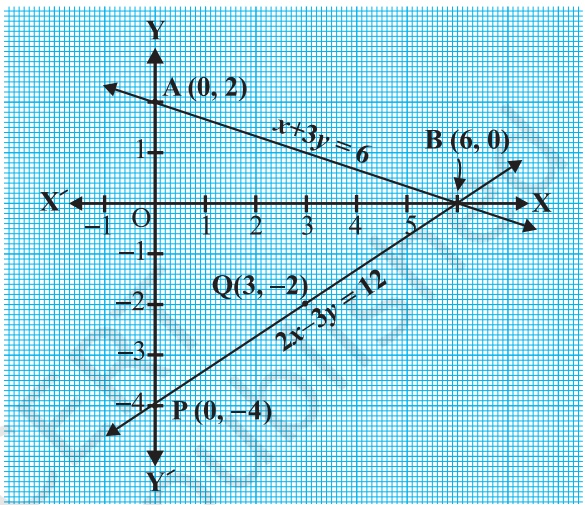

| x | 0 | 6 |
| --- | --- | --- |
| 6 - x y =3 | 2 | 0 |

Table 3.2

| x | 0 | 3 |
| --- | --- | --- |
| 2x - 12 y =3 | - 4 | -2 |

**Plot the points A(0, 2), B(6, 0), P(0, – 4) and Q(3, – 2) on graph paper, and join the points to form the lines AB and PQ as shown in Fig. 3.1.**

**We observe that there is a point B (6, 0) common to both the lines AB and PQ. So, the solution of the pair of linear equations is** x **= 6 and** $y   =   0$ **, i.e., the given pair of equations is consistent.**

Fig. 3.1

**Example 2 : Graphically, find whether the following pair of equations has no solution, unique solution or infinitely many solutions:**

$$
5x - 8y + Y = 0\tag{1}
$$

$$
3x - \frac{24}{5}y + \frac{3}{5} = 0\tag{2}
$$

**Solution : Multiplying Equation (2) by** $\frac { 5 } { 3 }$ , **we get**

$$
5 x - 8 y + 1 = 0
$$

**But, this is the same as Equation (1). Hence the lines represented by Equations (1) and (2) are coincident. Therefore, Equations (1) and (2) have infinitely many solutions.**

**Plot few points on the graph and verify it yourself.**

**Example 3 : Champa went to a ‘Sale’ to purchase some pants and skirts. When her friends asked her how many of each she had bought, she answered, “The number of skirts is two less than twice the number of pants purchased. Also, the number of skirts is four less than four times the number of pants purchased”. Help her friends to find how many pants and skirts Champa bought.**