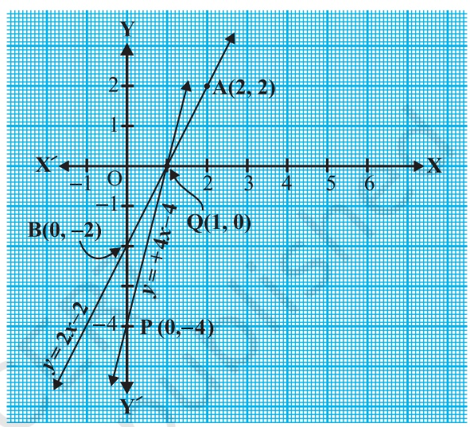

**Solution : Let us denote the number of pants by** x **and the number of skirts by** y. **Then the equations formed are :**

$$
y = 2 x - 2\tag{1}
$$

**and**

$$
y = 4 x - 4\tag{2}
$$

**Let us draw the graphs of Equations (1) and (2) by finding two solutions for each of the equations. They are given in Table 3.3.**

Table 3.3

| x | 2 | 0 |
| --- | --- | --- |
| y = 2x - 2 | 2 | - 2 |

| x | 0 | 1 |
| --- | --- | --- |
| y = 4x - 4 | - 4 | 0 |

Fig. 3.2

**Plot the points and draw the lines passing through them to represent the equations, as shown in Fig. 3.2.**

**The two lines intersect at the point (1, 0). So,** x **= 1,** y **= 0 is the required solution of the pair of linear equations, i.e., the number of pants she purchased is 1 and she did not buy any skirt.**

**Verify the answer by checking whether it satisfies the conditions of the given problem.**

## EXERCISE 3.1

**1. Form the pair of linear equations in the following problems, and find their solutions graphically.**

**(i) 10 students of Class X took part in a Mathematics quiz. If the number of girls is 4 more than the number of boys, find the number of boys and girls who took part in the quiz.**