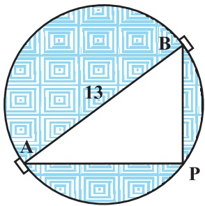

$$
\mathrm{If} b^2 - 4ac = 0, then x = -\frac{b}{2a} \pm 0, \mathrm{i.e.}, x = -\frac{b}{2a} \mathrm{or} -\frac{b}{2a}
$$

So, the roots of the equation $a x ^ { 2 } + b x + c = 0$ are both ${ \frac { - b } { 2 a } } .$

Therefore, we say that the quadratic equation $ax^{2} + bx + c = 0$ has two equal real roots in this case.

If $b ^ { 2 }   -   4 a c   <   0$ , then there is no real number whose square is $b ^ { 2 }   -   4 a c$ . Therefore, there are no real roots for the given quadratic equation in this case.

Since $b ^ { 2 } - 4 a c$ determines whether the quadratic equation $ax^{2}+bx+c=0$ has real roots or not, $b ^ { 2 } - 4 a c$ is called the **discriminant** of this quadratic equation.

So, a quadratic equation $ax^{2}+bx+c=0$ has

(i) two distinct real roots, if $b ^ { 2 } - 4 a c > 0 ,$

(ii) two equal real roots, if $b^{2}-4ac=0,$

(iii) no real roots, if $b ^ { 2 } - 4 a c < 0 ,$

Let us consider some examples.

**Example 7:** Find the discriminant of the quadratic equation $2x^{2} - 4x + 3 = 0$ , and hence find the nature of its roots.

**Solution :** The given equation is of the form $ax^{2}+bx+c=0$ , where $a = 2,   b = -4$ and $c = 3$ . Therefore, the discriminant

$$
b^{2}-4\overline{ac}=(-4)^{2}-(4\times2\times3)=16-24=-8<0
$$

So, the given equation has no real roots.

**Example 8 :** A pole has to be erected at a point on the boundary of a circular park of diameter 13 metres in such a way that the differences of its distances from two diametrically opposite fixed gates A and B on the boundary is 7 metres. Is it possible to do so? If yes, at what distances from the two gates should the pole be erected?

**Solution :** Let us first draw the diagram (see Fig. 4.2).

Let P be the required location of the pole. Let the distance of the pole from the gate B be x m, i.e., $\mathrm { B P }   =   x \mathrm { ~ m ~ }$ . Now the difference of the distances of the pole from the two gates = AP – BP (or, $\mathrm{BP-AP} =$ 7 m. Therefore, $\mathrm{AP} = (x + 7) \mathrm{m}$

Fig. 4.2