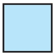
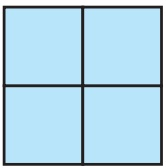
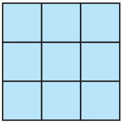
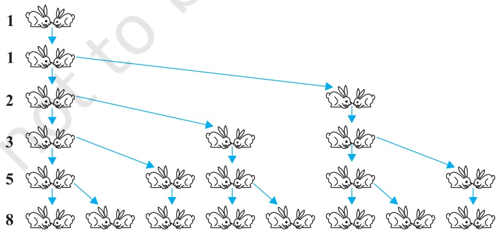

(iv) The number of unit squares in squares with side 1, 2, 3, . . . units (see Fig. 5.2) are, respectively 12, 22, 32, . . . .

Fig. 5.2

(v) Shakila puts \` 100 into her daughter’s money box when she was one year old and increased the amount by \` 50 every year. The amounts of money (in \`) in the box on the 1st, 2nd, 3rd, 4th, . . . birthday were 100, 150, 200, 250, . . ., respectively.

(vi) A pair of rabbits are too young to produce in their first month. In the second, and every subsequent month, they produce a new pair. Each new pair of rabbits produce a new pair in their second month and in every subsequent month (see Fig. 5.3). Assuming no rabbit dies, the number of pairs of rabbits at the start of the 1st, 2nd, 3rd, . . ., 6th month, respectively are :

## 1, 1, 2, 3, 5, 8

Fig. 5.3