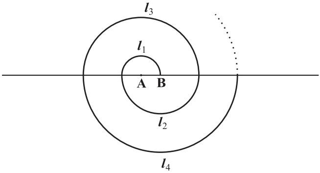
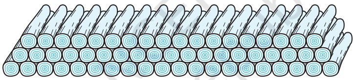
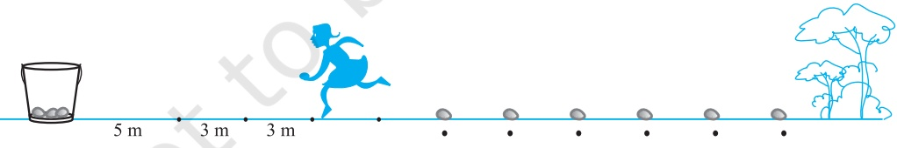

Fig. 5.4

[**Hint :** Length of successive semicircles is $l _ { 1 } , l _ { 2 } , l _ { 3 } , l _ { 4 } , \ldots$ . with centres at $\mathrm { A } , \mathrm { B } , \mathrm { A } , \mathrm { B } , \ldots ,$ respectively.]

**19.** 200 logs are stacked in the following manner: 20 logs in the bottom row, 19 in the next row, 18 in the row next to it and so on (see Fig. 5.5). In how many rows are the 200 logs placed and how many logs are in the top row?

Fig. 5.5

**20.** In a potato race, a bucket is placed at the starting point, which is 5 m from the first potato, and the other potatoes are placed 3 m apart in a straight line. There are ten potatoes in the line (see Fig. 5.6).

Fig. 5.6

A competitor starts from the bucket, picks up the nearest potato, runs back with it, drops it in the bucket, runs back to pick up the next potato, runs to the bucket to drop it in, and she continues in the same way until all the potatoes are in the bucket. What is the total distance the competitor has to run?

[**Hint :** To pick up the first potato and the second potato, the total distance (in metres) run by a competitor is $2 \times 5 + 2 \times (5 + 3)$ 1