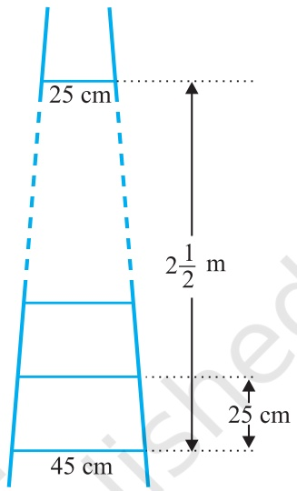
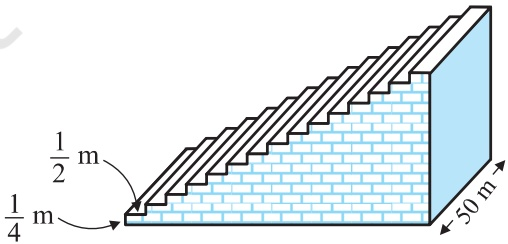

## EXERCISE 5.4 (Optional)\*

**1.** Which term of the AP : 121, 117, 113, . . ., is its first negative term? [**Hint :** Find n for $[ a _ { _ n }   <   0 ]$

**2.** The sum of the third and the seventh terms of an AP is 6 and their product is 8. Find the sum of first sixteen terms of the AP.

**3.** A ladder has rungs 25 cm apart. (see Fig. 5.7). The rungs decrease uniformly in length from 45 cm at the bottom to 25 cm at the top. If the top and the bottom rungs are $2 { \frac { 1 } { 2 } }$ m apart, what is the length of the wood required for the rungs?

[**Hint :** Number of rungs $= { \frac { 2 5 0 } { 2 5 } }   +   1 1$

Fig. 5.7

**4.** The houses of a row are numbered consecutively from 1 to 49. Show that there is a value of x such that the sum of the numbers of the houses preceding the house numbered x is equal to the sum of the numbers of the houses following it. Find this value of x.

[**Hint :** $S_{x - 1} = S_{49} - S_{x}$

**5.** A small terrace at a football ground comprises of 15 steps each of which is 50 m long and built of solid concrete.

Each step has a rise of $\frac { 1 } { 4 }$ m and a tread of $\frac { 1 } { 2 }$ m. (see Fig. 5.8). Calculate the total volume of concrete required to build the terrace.

[**Hint :** Volume of concrete required to build the first step $= \frac { 1 } { 4 } \times \frac { 1 } { 2 } \times 5 0 \; \mathrm { m } ^ { 3 }   ]$

Fig. 5.8

<small>\* These exercises are not from the examination point of view.</small>