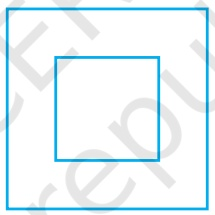
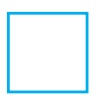
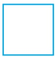
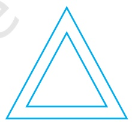
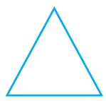
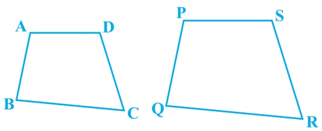

(i)

been measured directly with the help of a measuring tape? In fact, all these heights and distances have been found out using the idea of indirect measurements, which is based on the principle of similarity of figures (see Example 7, Q.15 of Exercise 6.3 and also Chapters 8 and 9 of this book).

## 6.2 Similar Figures

In Class IX, you have seen that all circles with the same radii are congruent, all squares with the same side lengths are congruent and all equilateral triangles with the

same side lengths are congruent.

Now consider any two (or more) circles [see Fig. 6.1 (i)]. Are they congruent? Since all of them do not have the same radius, they are not congruent to each other. Note that some are congruent and some are not, but all of them have the same shape. So they all are, what we call, similar. Two similar figures have the same shape but not necessarily the same size. Therefore, all circles are similar. What about two (or more) squares or two (or more) equilateral triangles [see Fig. 6.1 (ii) and (iii)]? As observed in the case of circles, here also all squares are similar and all equilateral triangles are similar.

From the above, we can say that all congruent figures are similar but the similar figures need not be congruent.

Can a circle and a square be similar? Can a triangle and a square be similar? These questions can be answered by just looking at the figures (see Fig. 6.1). Evidently these figures are not similar. (Why?)

(ii)

(iii)

Fig. 6.1

Fig. 6.2