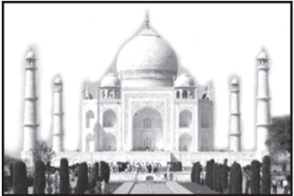
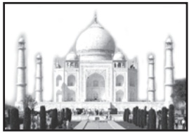

What can you say about the two quadrilaterals ABCD and PQRS (see Fig 6.2)?Are they similar? These figures appear to be similar but we cannot be certain about it.Therefore, we must have some definition of similarity of figures and based on this definition some rules to decide whether the two given figures are similar or not. For this, let us look at the photographs given in Fig. 6.3:

Fig. 6.3

You will at once say that they are the photographs of the same monument (Taj Mahal) but are in different sizes. Would you say that the three photographs are similar? Yes,they are.

What can you say about the two photographs of the same size of the same person one at the age of 10 years and the other at the age of 40 years? Are these photographs similar? These photographs are of the same size but certainly they are not of the same shape. So, they are not similar.

What does the photographer do when she prints photographs of different sizes from the same negative? You must have heard about the stamp size, passport size and postcard size photographs. She generally takes a photograph on a small size film, say of 35mm size and then enlarges it into a bigger size, say 45mm (or 55mm). Thus, if we consider any line segment in the smaller photograph (figure), its corresponding line

$$
\left[ { \frac { 4 5 } { 3 5 } } { \left( \mathrm { o r }   { \frac { 5 5 } { 3 5 } } \right) } \right]
$$

This really means that every line segment of the smaller photograph is enlarged (increased) in the ratio 35:45 (or 35:55). It can also be said that every line segment of the bigger photograph is reduced (decreased) in the ratio 45:35 (or 55:35). Further, if you consider inclinations (or angles) between any pair of corresponding line segments in the two photographs of different sizes, you shall see that these inclinations(or angles) are always equal. This is the essence of the similarity of two figures and in particular of two polygons. We say that:

Two polygons of the same number of sides are similar, if (i) their corresponding angles are equal and (ii) their corresponding sides are in the same ratio (or proportion).