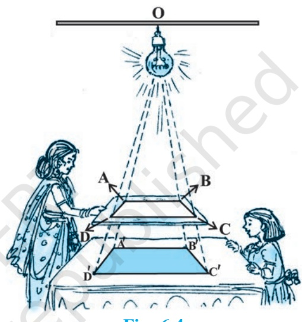

Note that the same ratio of the corresponding sides is referred to as the scale factor (or the Representative Fraction) for the polygons. You must have heard that world maps (i.e., global maps) and blue prints for the construction of a building are prepared using a suitable scale factor and observing certain conventions.

In order to understand similarity of figures more clearly, let us perform the following activity:

Activity 1 : Place a lighted bulb at a point O on the ceiling and directly below it a table in your classroom. Let us cut a polygon, say a quadrilateral ABCD, from a plane cardboard and place this cardboard parallel to the ground between the lighted bulb and the table. Then a shadow of ABCD is cast on the table. Mark the outline of this shadow as $\mathrm { A ^ { \prime } B ^ { \prime } C ^ { \prime } D ^ { \prime } }$ (see Fig.6.4).

Note that the quadrilateral $\mathrm { A ^ { \prime } B ^ { \prime } C ^ { \prime } D ^ { \prime } }$ is an enlargement (or magnification) of the quadrilateral ABCD. This is because of the property of light that light propogates in a straight line. You may also note that $\mathrm { A ^ { \prime } }$ lies on ray OA, B' lies on ray OB, C'

Fig. 6.4

lies on OC and D' lies on OD. Thus, quadrilaterals $\mathrm { A ^ { \prime } B ^ { \prime } C ^ { \prime } D ^ { \prime } }$ and ABCD are of the same shape but of different sizes.

So, quadrilateral $\mathrm { A ^ { \prime } B ^ { \prime } C ^ { \prime } D ^ { \prime } }$ is similiar to quadrilateral ABCD. We can also say that quadrilateral ABCD is similar to the quadrilateral $\mathrm { A ^ { \prime } B ^ { \prime } C ^ { \prime } D ^ { \prime } }$

Here, you can also note that vertex $\mathrm { A ^ { \prime } }$ corresponds to vertex A, vertex $\mathrm { B ^ { \prime } }$ corresponds to vertex B, vertex C' corresponds to vertex C and vertex D' corresponds to vertex D. Symbolically, these correspondences are represented as $\mathrm { A } ^ { \prime }   \leftrightarrow   \mathrm { A } , \mathrm { B } ^ { \prime }   \leftrightarrow   \mathrm { B }$ $\mathbf { C } ^ { \prime } \leftrightarrow \mathbf { C }$ and $\mathrm { D ^ { \prime } } \leftrightarrow \mathrm { D }$ By actually measuring the angles and the sides of the two quadrilaterals, you may verify that

(i) $\angle \mathrm{A} = \angle \mathrm{A}', \angle \mathrm{B} = \angle \mathrm{B}', \angle \mathrm{C} = \angle \mathrm{C}', \angle \mathrm{D} = \angle \mathrm{D}'$ and

$$
\frac{\mathrm{AB}}{\mathrm{A}^{\prime} \mathrm{B}^{\prime}}=\frac{\mathrm{BC}}{\mathrm{B}^{\prime} \mathrm{C}^{\prime}}=\frac{\mathrm{CD}}{\mathrm{C}^{\prime} \mathrm{D}^{\prime}}=\frac{\mathrm{DA}}{\mathrm{D}^{\prime} \mathrm{A}^{\prime}}
$$

This again emphasises that two polygons of the same number of sides are similar, if (i) all the corresponding angles are equal and (ii) all the corresponding sides are in the same ratio (or proportion).