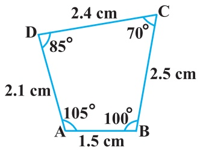
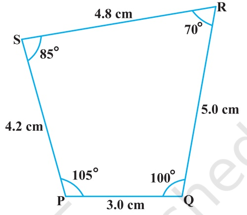
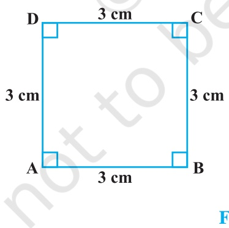
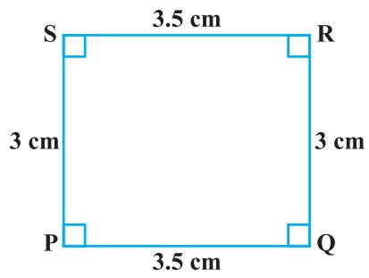

From the above, you can easily say that quadrilaterals ABCD and PQRS of Fig. 6.5 are similar.

Fig. 6.5

**Remark :** You can verify that if one polygon is similar to another polygon and this second polygon is similar to a third polygon, then the first polygon is similar to the third polygon.

You may note that in the two quadrilaterals (a square and a rectangle) of Fig. 6.6, corresponding angles are equal, but their corresponding sides are not in the same ratio.

Fig. 6.6

So, the two quadrilaterals are not similar. Similarly, you may note that in the two quadrilaterals (a square and a rhombus) of Fig. 6.7, corresponding sides are in the same ratio, but their corresponding angles are not equal. Again, the two polygons (quadrilaterals) are not similar.