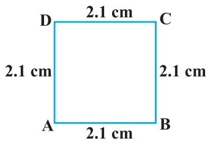
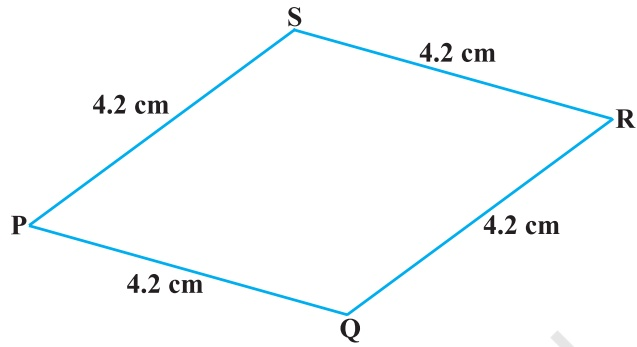
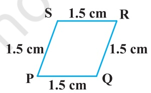
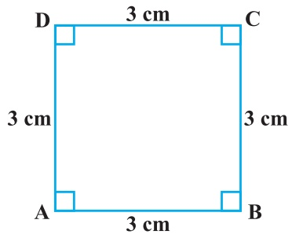

Fig. 6.7

Thus, either of the above two conditions (i) and (ii) of similarity of two polygons is not sufficient for them to be similar.

## EXERCISE 6.1

**1.** Fill in the blanks using the correct word given in brackets :

(i) All circles are . (congruent, similar)

(ii) All squares are . (similar, congruent)

(iii) All triangles are similar. (isosceles, equilateral)

(iv) Two polygons of the same number of sides are similar, if (a) their corresponding angles are and (b) their corresponding sides are . (equal, proportional)

**2.** Give two different examples of pair of

(i) similar figures. (ii) non-similar figures.

**3.** State whether the following quadrilaterals are similar or not:

Fig. 6.8