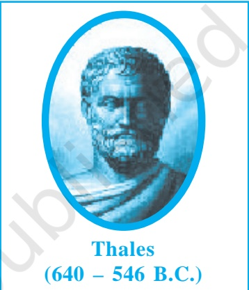
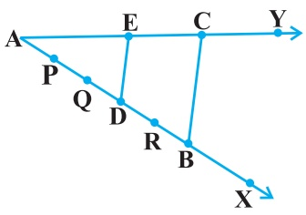

## 6.3 Similarity of Triangles

What can you say about the similarity of two triangles?

You may recall that triangle is also a polygon. So, we can state the same conditions for the similarity of two triangles. That is:

Two triangles are similiar, if

(i) their corresponding angles are equal and

(ii) their corresponding sides are in the same ratio (or proportion).

Note that if corresponding angles of two triangles are equal, then they are known as equiangular triangles. A famous Greek mathematician Thales gave an important truth relating to two equiangular triangles which is as follows:

The ratio of any two corresponding sides in two equiangular triangles is always the same.

It is believed that he had used a result called the Basic Proportionality Theorem (now known as the Thales Theorem) for the same.

To understand the Basic Proportionality Theorem, let us perform the following activity:

**Activity 2 :** Draw any angle XAY and on its one arm AX, mark points (say five points) P, Q, D, R and B such that $\mathrm{AP} = \mathrm{PQ} = \mathrm{QD} = \mathrm{DR} = \mathrm{RB}$

Now, through B, draw any line intersecting arm AY at C (see Fig. 6.9).

Also, through the point D, draw a line parallel to BC to intersect AC at E. Do you observe from your constructions that $\frac { \mathrm { A D } } { \mathrm { D B } }   =   \frac { 3 } { 2 }   ?$ Measure AE and

Fig. 6.9

EC. What about $\frac { \mathrm { A E } } { \mathrm { E C } }$ ? Observe that $\frac { \mathrm { A E } } { \mathrm { E C } }$ is also equal to $\frac { 3 } { 2 }$ . Thus, you can see that in $\Delta   \mathrm { A B C }$ , DE || BC and $\frac { \mathrm { A D } } { \mathrm { D B } }   =   \frac { \mathrm { A E } } { \mathrm { E C } }$ . Is it a coincidence? No, it is due to the following theorem (known as the Basic Proportionality Theorem):