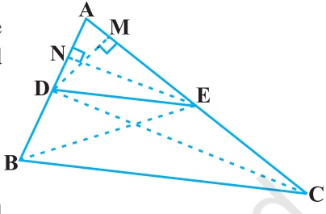

**Theorem 6.1 :** If a line is drawn parallel to one side of a triangle to intersect the other two sides in distinct points, the other two sides are divided in the same ratio.

**Proof :** We are given a triangle ABC in which a line parallel to side BC intersects other two sides AB and AC at D and E respectively (see Fig. 6.10).

We need to prove that $\frac { \mathrm { A D } } { \mathrm { D B } }   =   \frac { \mathrm { A E } } { \mathrm { E C } }$

Let us join BE and CD and then draw $\mathrm { D M } \bot \mathrm { A C }$ and $\mathrm { E N } \perp \mathrm { A B }$

Fig. 6.10

Now, area of $\Delta \mathrm { A D E } ( = { \frac { 1 } { 2 } } \mathrm { b a s e } \times \mathrm { h e i g h t } ) = { \frac { 1 } { 2 } } \mathrm { A D } \times \mathrm { E N } .$

Recall from Class IX, that area of $\Delta   \mathrm { A D E }$ is denoted as ar(ADE).

So,

$$
\mathrm{ar}(\mathrm{ADE}) = \frac{1}{2} \mathrm{AD} \times \mathrm{EN}
$$

Similarly,

$$
\mathrm{ar}(\mathrm{BDE}) = \frac{1}{2} \mathrm{DB} \times \mathrm{EN},
$$

$$
\mathrm{ar}(\mathrm{ADE})=\frac{1}{2}\mathrm{AE}\times\mathrm{DM}\ \mathrm{and}\ \mathrm{ar}(\mathrm{ DEC})=\frac{1}{2}\mathrm{EC}\times\mathrm{DM}.
$$

Therefore,

$$
\frac{\frac{1}{2}\mathrm{AD} \times \mathrm{EN}}{\frac{1}{2}\mathrm{DB} \times \mathrm{EN}} = \frac{\frac{1}{2}\mathrm{AD} \times \mathrm{EN}}{\frac{1}{2}\mathrm{DB} \times \mathrm{EN}} = \frac{\mathrm{AD}}{\mathrm{DB}}\tag{1}
$$

and

$$
\frac{\mathrm{ar}(\mathrm{ADE})}{\mathrm{ar}(\mathrm{DEC})}=\frac{\frac{1}{2}\mathrm{AE}\times\mathrm{DM}}{\frac{1}{2}\mathrm{EC}\times\mathrm{DM}}=\frac{\mathrm{AE}}{\mathrm{EC}}\tag{2}
$$

Note that $\Delta$ BDE and DEC are on the same base DE and between the same parallels BC and DE.

So,

$$
\mathrm{ar}(\mathrm{BDE}) = \mathrm{ar}(\mathrm{DEC})\tag{3}
$$