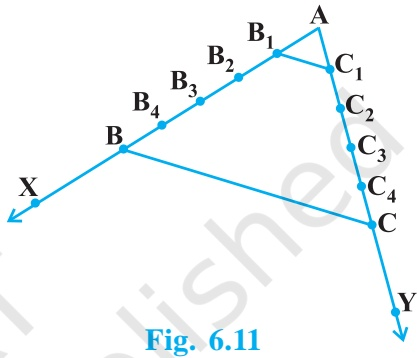

Therefore, from (1), (2) and (3), we have :

$$
{ \frac { \mathrm { A D } } { \mathrm { D B } } } = { \frac { \mathrm { A E } } { \mathrm { E C } } }
$$

Is the converse of this theorem also true (For the meaning of converse, see Appendix 1)? To examine this, let us perform the following activity:

**Activity 3 :** Draw an angle XAY on your notebook and on ray AX, mark points $\mathbf { B } _ { 1 } ,   \mathbf { B } _ { 2 } ,$ $\mathbf { B } _ { 3 } ,   \mathbf { B } _ { 4 }$ and B such that $\mathrm{AB}_{1}=\mathrm{B}_{1} \mathrm{B}_{2}=\mathrm{B}_{2} \mathrm{B}_{3}=$ $\mathbf { \widetilde { B _ { 3 } } } \mathbf { \widetilde { B _ { 4 } } } = \mathbf { B _ { 4 } } \mathbf { B }$

Similarly, on ray AY, mark points $C_{1}, C_{2}, C_{3}, C_{4}$ and C such that $\mathrm{AC}_{1} = \mathrm{C}_{1}\mathrm{C}_{2}$ $C_{2}C_{3}=C_{3}C_{4}=C_{4}C$ . Then join $\mathrm { B _ { 1 } C _ { 1 } }$ and BC (see Fig. 6.11).

Note that

$$
\frac{\mathrm{AB}_{1}}{\mathrm{B}_{1}\mathrm{B}}=\frac{\mathrm{AC}_{1}}{\mathrm{C}_{1}\mathrm{C}}\left(\text { Each equal } \cup \frac{1}{4}\right)
$$

You can also see that lines $\mathrm{B_{1}C_{1}}$ and BC are parallel to each other, i.e.,

$$
B _{1} C _{1}\parallel  BC\tag{1}
$$

Similarly, by joining $\mathrm{B}_{2} \mathrm{C}_{2}, \mathrm{B}_{3} \mathrm{C}_{3}$ and $\mathrm { B _ { 4 } C _ { 4 } } ;$ you can see that:

$$
\frac{\mathrm{AB}_{2}}{\mathrm{B}_{2}\mathrm{B}}=\frac{\mathrm{AC}_{2}}{\mathrm{C}_{2}\mathrm{C}}\left(=\frac{2}{3}\right)\text { and }\mathrm{B}_{2}\mathrm{C}_{2}\parallel\mathrm{BC}\tag{2}
$$

$$
\frac{\mathrm{AB}_{3}}{\mathrm{B}_{3}\mathrm{B}}=\frac{\mathrm{AC}_{3}}{\mathrm{C}_{3}\mathrm{C}}\left(=\frac{3}{2}\right)\text { and }\mathrm{B}_{3}\mathrm{C}_{3}\parallel\mathrm{BC}\tag{3}
$$

$$
\frac{\mathrm{AB}_{4}}{\mathrm{B}_{4}\mathrm{B}}=\frac{\mathrm{AC}_{4}}{\mathrm{C}_{4}\mathrm{C}}\left(=\frac{4}{1}\right)\text { and }\mathrm{B}_{4}\mathrm{C}_{4}\parallel\mathrm{BC}\tag{4}
$$

From (1), (2), (3) and (4), it can be observed that if a line divides two sides of a triangle in the same ratio, then the line is parallel to the third side.

You can repeat this activity by drawing any angle XAY of different measure and taking any number of equal parts on arms AX and AY . Each time, you will arrive at the same result. Thus, we obtain the following theorem, which is the converse of Theorem 6.1: