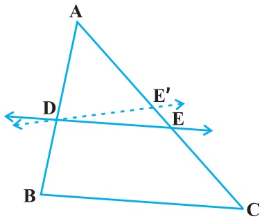
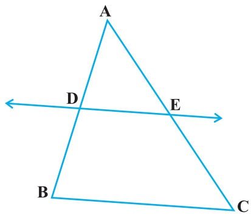

(Why ?)

**Theorem 6.2 :** If a line divides any two sides of a triangle in the same ratio, then the line is parallel to the third side.

This theorem can be proved by taking a line DE such that $\frac { \mathrm { A D } } { \mathrm { D B } }   =   \frac { \mathrm { A E } } { \mathrm { E C } }$ and assuming that DE is not parallel to BC (see Fig. 6.12).

If DE is not parallel to BC, draw a line DE parallel to BC.

Fig. 6.12

So,

$$
\left[ \frac{ AD }{ DB } = \frac{ AE '}{ E ' C } \right.\tag{Why ?}
$$

Therefore,

$$
\left[ \frac{ AE }{ EC } = \frac{ AE '}{ EC } \right.
$$

$\mathrm { E ^ { \prime } }$ must coincide. (Why ?)

Let us take some examples to illustrate the use of the above theorems.

**Example 1 :** If a line intersects sides AB and AC of a $\Delta   \mathrm { A B C }$ at D and E respectively and is parallel to BC, prove that $\frac{ AD }{ AB } = \frac{ AE }{ AC }$ (see Fig. 6.13).

**Solution :**

$$
DE  \parallel  BC\tag{Given}
$$

So,

$$
\frac{ AD }{ DB } = \frac{ AE }{ EC }\tag{or,}
$$

$$
{ \frac { \mathrm { D B } } { \mathrm { A D } } } = { \frac { \mathrm { E C } } { \mathrm { A E } } }\tag{or,}
$$

$$
\left\{ { \frac { \mathrm { D B } } { \mathrm { A D } } } + 1 = { \frac { \mathrm { E C } } { \mathrm { A E } } } + 1 \right.\tag{or,}
$$

$$
{ \frac { \mathrm { A B } } { \mathrm { A D } } } =   { \frac { \mathrm { A C } } { \mathrm { A E } } }
$$

So,

$$
\left[ { \frac { \mathrm { A D } } { \mathrm { A B } } } = { \frac { \mathrm { A E } } { \mathrm { A C } } } \right]
$$

(Theorem 6.1)

Fig. 6.13