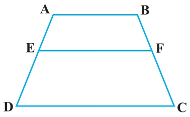
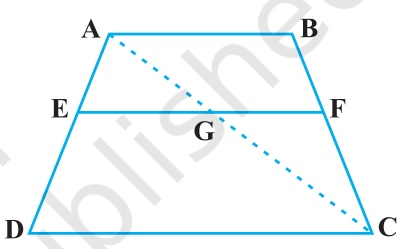
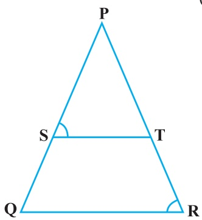

**Example 2 :** ABCD is a trapezium with AB || DC. E and F are points on non-parallel sides AD and BC respectively such that EF is parallel to AB

(see Fig. 6.14). Show that $\frac { \mathrm { A E } } { \mathrm { E D } }   =   \frac { \mathrm { B F } } { \mathrm { F C } }$

**Solution :** Let us join AC to intersect EF at G (see Fig. 6.15).

AB || DC and EF || AB (Given)

So, $\mathrm { E F } \parallel \mathrm { D C }$ (Lines parallel to the same line are parallel to each other)

Now, in $\Delta   \mathrm { A D C }$

$$
EG  \parallel  DC  \quad ( As EF  \parallel  DC )
$$

So, ${ \frac { \mathrm { A E } } { \mathrm { E D } } }   =   { \frac { \mathrm { A G } } { \mathrm { G C } } }$ (Theorem 6.1)

(1)

Similarly, from $\Delta \mathrm { C A B }$

Fig. 6.14

$$
\frac{ CG }{ AG } \equiv \frac{ GF }{ BF }
$$

$$
\frac{\mathrm{AG}}{\mathrm{GC}}=\frac{\mathrm{BF}}{\mathrm{FC}}
$$

Fig. 6.15

i.e.,

Therefore, from (1) and (2),

$$
{ \frac { \mathrm { A E } } { \mathrm { E D } } } =   { \frac { \mathrm { B F } } { \mathrm { F C } } }\tag{2}
$$

**Example 3 :** In Fig. 6.16, ${ \frac { \mathrm { P S } } { \mathrm { S Q } } } = { \frac { \mathrm { P T } } { \mathrm { T R } } }$ and $\angle \mathrm{PST} =$ $\angle \operatorname { P R Q } ,$ . Prove that PQR is an isosceles triangle.

**Solution :** It is given that $\frac { \mathrm { P S } } { \mathrm { S Q } }   =   \frac { \mathrm { P T } } { \mathrm { T R } }$

Fig. 6.16

So, ST || QR (Theorem 6.2) Therefore, $\angle \mathrm{PST} = \angle \mathrm{PQR}$ (Corresponding angles) (1)