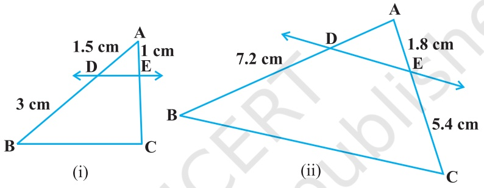
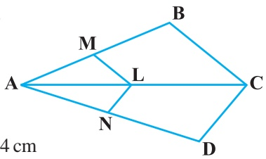
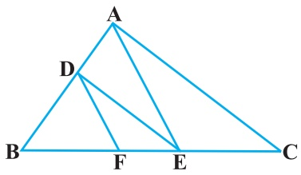

Also, it is given that

$$
\angle \mathrm{PST} = \angle \mathrm{PRQ}\tag{2}
$$

So,

$\angle \mathrm{PRQ} = \angle \mathrm{PQR}$ [From (1) and (2)]

Therefore,

PQ = PR (Sides opposite the equal angles)

i.e., PQR is an isosceles triangle.

## EXERCISE 6.2

**1.** In Fig. 6.17, (i) and (ii), DE || BC. Find EC in (i) and AD in (ii).

Fig. 6.17

**2.** E and F are points on the sides PQ and PR respectively of a   PQR. For each of the following cases, state whether EF || QR :

(i) $PE=3.9   cm ,  EQ =3   cm ,  PF =3.6   cm   and   FR =2.4   cm$

(ii) $PE=4 cm , QE=4.5 cm , PF=8 cm  and RF=9 cm$

Fig. 6.18

(iii) PQ = 1.28 cm, PR = 2.56 cm, PE = 0.18 cm and PF = 0.36 cm

**3.** In Fig. 6.18, if LM || CB and LN || CD, prove that $\frac{AM}{AB} = \frac{AN}{AD}$

**4.** In Fig. 6.19, DE || AC and DF || AE. Prove that ${ \frac { \mathrm { B F } } { \mathrm { F E } } } = { \frac { \mathrm { B E } } { \mathrm { E C } } } \cdotp$

Fig. 6.19