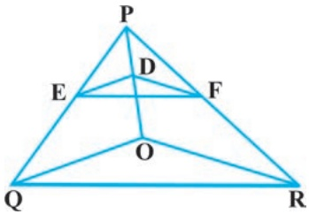
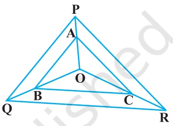
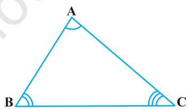
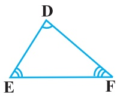

**5.** In Fig. 6.20, DE || OQ and DF || OR. Show that EF || QR.

**6.** In Fig. 6.21, A, B and C are points on OP, OQ and OR respectively such that AB || PQ and AC || PR. Show that BC || QR.

**7.** Using Theorem 6.1, prove that a line drawn through the mid-point of one side of a triangle parallel to another side bisects the third side. (Recall that you have proved it in Class IX).

Fig. 6.20

**8.** Using Theorem 6.2, prove that the line joining the mid-points of any two sides of a triangle is parallel to the third side. (Recall that you have done it in Class IX).

**9.** ABCD is a trapezium in which AB || DC and its diagonals intersect each other at the point O. Show that ${ \frac { \mathrm { A O } } { \mathrm { B O } } } = { \frac { \mathrm { C O } } { \mathrm { D O } } }$

Fig. 6.21

**10.** The diagonals of a quadrilateral ABCD intersect each other at the point O such that ${ \frac { \mathrm { A O } } { \mathrm { B O } } } = { \frac { \mathrm { C O } } { \mathrm { D O } } }$ Show that ABCD is a trapezium.

## 6.4 Criteria for Similarity of Triangles

In the previous section, we stated that two triangles are similar, if (i) their corresponding angles are equal and (ii) their corresponding sides are in the same ratio (or proportion).

That is, in $\Delta   \mathrm { A B C }$ and   DEF, if

(i) $\angle \mathrm{A} = \angle \mathrm{D}, \angle \mathrm{B} = \angle \mathrm{E}, \angle \mathrm{C} = \angle \mathrm{F}$ and

(ii) $\frac{\mathrm{AB}}{\mathrm{DE}}=\frac{\mathrm{BC}}{\mathrm{EE}}=\frac{\mathrm{CA}}{\mathrm{FD}}$ then the two triangles are similar (see Fig. 6.22).

Fig. 6.22

