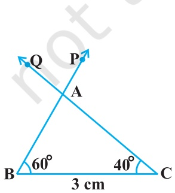
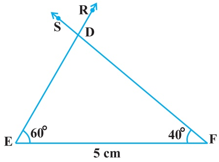

Here, you can see that A corresponds to D, B corresponds to E and C corresponds to F. Symbolically, we write the similarity of these two triangles as $\Delta  ABC  \sim \Delta  DEF$ and read it as ‘triangle ABC is similar to triangle DEF’. The symbol ‘\~’ stands for ‘is similar to’. Recall that you have used the symbol ‘ ’ for ‘is congruent to’ in Class IX.

It must be noted that as done in the case of congruency of two triangles, the similarity of two triangles should also be expressed symbolically, using correct correspondence of their vertices. For example, for the triangles ABC and DEF of Fig. 6.22, we cannot write ∆ ABC ∼ ∆ EDF or ∆ ABC ∼ ∆ FED. However, we can write $\Delta \; \mathrm { B A C } \sim \Delta$ EDF.

Now a natural question arises : For checking the similarity of two triangles, say ABC and DEF, should we always look for all the equality relations of their corresponding angles $\left( \angle \mathrm{A} = \angle \mathrm{D}, \angle \mathrm{B} = \angle \mathrm{E}, \angle \mathrm{C} = \angle \mathrm{F} \right)$ and all the equality relations of the ratios of their corresponding sides $\left( \frac{\mathrm{AB}}{\mathrm{DE}} = \frac{\mathrm{BC}}{\mathrm{EF}} = \frac{\mathrm{CA}}{\mathrm{FD}} \right)$ Let us examine. You may recall that in Class IX, you have obtained some criteria for congruency of two triangles involving only three pairs of corresponding parts (or elements) of the two triangles. Here also, let us make an attempt to arrive at certain criteria for similarity of two triangles involving relationship between less number of pairs of corresponding parts of the two triangles, instead of all the six pairs of corresponding parts. For this, let us perform the following activity:

**Activity 4 :** Draw two line segments BC and EF of two different lengths, say 3 cm and 5 cm respectively. Then, at the points B and C respectively, construct angles PBC and QCB of some measures, say, $6 0 ^ { \circ }$ and $4 0 ^ { \circ }$ . Also, at the points E and F, construct angles REF and SFE of 60° and $4 0 ^ { \circ }$ respectively (see Fig. 6.23).

Fig. 6.23