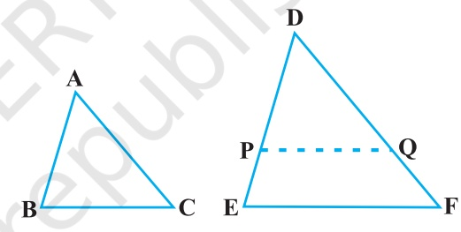

Let rays BP and CQ intersect each other at A and rays ER and FS intersect each other at D. In the two triangles ABC and DEF, you can see that $\angle \mathrm{B} = \angle \mathrm{E}, \angle \mathrm{C} = \angle \mathrm{F}$ and $\angle \mathrm{A} = \angle \mathrm{D}$ . That is, corresponding angles of these two triangles are equal. What can you say about their corresponding sides ? Note that $\frac { \mathrm { B C } } { \mathrm { E F } }   =   \frac { 3 } { 5 }   =   0 . 6$ . What about $\frac { \mathrm { A B } } { \mathrm { D E } }$ and $\frac { \mathrm { C A } } { \mathrm { F D } }   _ { 2 }$ On measuring AB, DE, CA and FD, you will find that $\frac { \mathrm { A B } } { \mathrm { D E } }$ and $\frac { \mathrm { C A } } { \mathrm { F D } }$ are also equal to 0.6 (or nearly equal to 0.6, if there is some error in the measurement). Thus, $\frac { \mathrm { A B } } { \mathrm { D E } } = \frac { \mathrm { B C } } { \mathrm { E F } } = \frac { \mathrm { C A } } { \mathrm { F D } }$ You can repeat this activity by constructing several pairs of triangles having their corresponding angles equal. Every time, you will find that their corresponding sides are in the same ratio (or proportion). This activity leads us to the following criterion for similarity of two triangles.

**Theorem 6.3 :** If in two triangles, corresponding angles are equal, then their corresponding sides are in the same ratio (or proportion) and hence the two triangles are similar. D

This criterion is referred to as the AAA (Angle–Angle–Angle) criterion of similarity of two triangles.

This theorem can be proved by taking two triangles ABC and DEF such that $\angle \mathrm{A} = \angle \mathrm{D}, \angle \mathrm{B} = \angle \mathrm{E}$ and $\angle \mathrm{C} = \angle \mathrm{F}$ (see Fig. 6.24)

Fig. 6.24

Cut $\mathrm { D P } = \mathrm { A B }$ and $\mathrm{DQ} = \mathrm{AC}$ and join PQ.

So,

ΔABC ≡ Δ DPQ (Why ?)

This gives

$\mathrm{B} \equiv \angle \mathrm{P} = \angle \mathrm{E}$ and $\mathrm { P Q } \parallel \mathrm { E F }$ (How?)

Therefore,

$$
\left[ \frac{\mathrm{DP}}{\mathrm{PE}} = \frac{\mathrm{DQ}}{\mathrm{QF}} \right.
$$

(Why?)

i.e.,

$$
\left[ \frac{ AB }{ DE } = \frac{ AC }{ DF } \right.\tag{Why?}
$$

Similarly, ${ \frac { \mathrm { ^ { \mathrm { \mathrm { { \mathrm { { \mathrm { { \mathrm { { } } } } } A } } } } B } } } { \mathrm { { \mathrm { { \mathrm { { D E } } } } } } } } = { \frac { \mathrm { { \mathrm { { \mathrm { { B C } } } } } } } { \mathrm { { \mathrm { { E F } } } } } }$ and so $\frac{\mathrm{AB}}{\mathrm{DE}}=\frac{\mathrm{BC}}{\mathrm{EF}}=\frac{\mathrm{AC}}{\mathrm{DF}}$

**Remark :** If two angles of a triangle are respectively equal to two angles of another triangle, then by the angle sum property of a triangle their third angles will also be equal. Therefore, AAA similarity criterion can also be stated as follows: