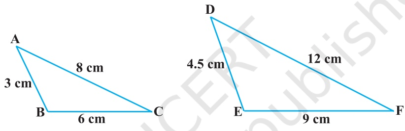

If two angles of one triangle are respectively equal to two angles of another triangle, then the two triangles are similar.

This may be referred to as the AA similarity criterion for two triangles.

You have seen above that if the three angles of one triangle are respectively equal to the three angles of another triangle, then their corresponding sides are proportional (i.e., in the same ratio). What about the converse of this statement? Is the converse true? In other words, if the sides of a triangle are respectively proportional to the sides of another triangle, is it true that their corresponding angles are equal? Let us examine it through an activity :

**Activity 5 :** Draw two triangles ABC and DEF such that $\mathbf { A B } = 3$ cm, $BC  \equiv 6$ 6 cm, CA = 8 cm, DE = 4.5 cm, EF = 9 cm and FD = 12 cm (see Fig. 6.25).

Fig. 6.25

So, you have :

$\frac{\mathrm{AB}}{\mathrm{DE}}=\frac{\mathrm{BC}}{\mathrm{EF}}=\frac{\mathrm{CA}}{\mathrm{FD}}$ (each equal to $\frac { 2 } { 3 } )$

Now measure $\angle \mathrm{A}, \angle \mathrm{B}, \angle \mathrm{C}, \angle \mathrm{D}, \angle \mathrm{E}$ and $\angle \mathrm { ~ F . ~ }$ You will observe that $\angle \mathrm{A} = \angle \mathrm{D}, \angle \mathrm{B} = \angle \mathrm{E}$ and $\angle C \equiv \angle  F$ i.e., the corresponding angles of the two triangles are equal.

You can repeat this activity by drawing several such triangles (having their sides in the same ratio). Everytime you shall see that their corresponding angles are equal. It is due to the following criterion of similarity of two triangles:

**Theorem 6.4 :** If in two triangles, sides of one triangle are proportional to (i.e., in the same ratio of ) the sides of the other triangle, then their corresponding angles are equal and hence the two triangles are similiar.

This criterion is referred to as the SSS (Side–Side–Side) similarity criterion for two triangles.

This theorem can be proved by taking two triangles ABC and DEF such that $\frac{\mathrm{AB}}{\mathrm{DE}}=\frac{\mathrm{BC}}{\mathrm{EF}}=\frac{\mathrm{CA}}{\mathrm{FD}} (<1)$ (see Fig. 6.26):