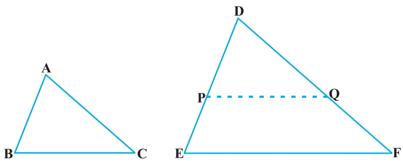

Fig. 6.26

Cut DP = AB and DQ = AC and join PQ.

It can be seen that

$$
\left[ \frac{\mathrm{DP}}{\mathrm{PE}} = \frac{\mathrm{DQ}}{\mathrm{QF}} \quad  and   \mathrm{PQ} \parallel \mathrm{EF} \quad (\mathrm{flow}?) \right]
$$

So,

$$
\angle \mathrm{P} = \angle \mathrm{E} \quad  and  \quad \angle \mathrm{Q} = \angle \mathrm{F}
$$

Therefore,

$$
\left( \frac{\mathrm{DP}}{\mathrm{DE}} = \frac{\mathrm{DQ}}{\mathrm{DF}} = \frac{\mathrm{PQ}}{\mathrm{EE}} \right)
$$

So,

$$
\frac{ DP }{ DE } = \frac{ DQ }{ DF } = \frac{ BC }{ EF } \quad ( Why? )
$$

So,

$$
BC \geq PQ
$$

(Why?)

Thus,

$$
\Delta  ABC  \cong \Delta  DPQ
$$

(Why ?)

So,

$$
\angle \mathrm{A} = \angle \mathrm{D}, \angle \mathrm{B} = \angle \mathrm{E} \quad  and  \quad \angle \mathrm{C} = \angle \mathrm{F} \quad (\mathrm{How} ?)
$$

**Remark :** You may recall that either of the two conditions namely, (i) corresponding angles are equal and (ii) corresponding sides are in the same ratio is not sufficient for two polygons to be similar. However, on the basis of Theorems 6.3 and 6.4, you can now say that in case of similarity of the two triangles, it is not necessary to check both the conditions as one condition implies the other.

Let us now recall the various criteria for congruency of two triangles learnt in Class IX. You may observe that SSS similarity criterion can be compared with the SSS congruency criterion.This suggests us to look for a similarity criterion comparable to SAS congruency criterion of triangles. For this, let us perform an activity.

**Activity 6 :** Draw two triangles ABC and DEF such that $AB = 2  cm , \angle A = 50^{\circ}$ $AC = 4   cm , DE = 3   cm , \angle D = 50^{\circ}$ and DF = 6 cm (see Fig.6.27).