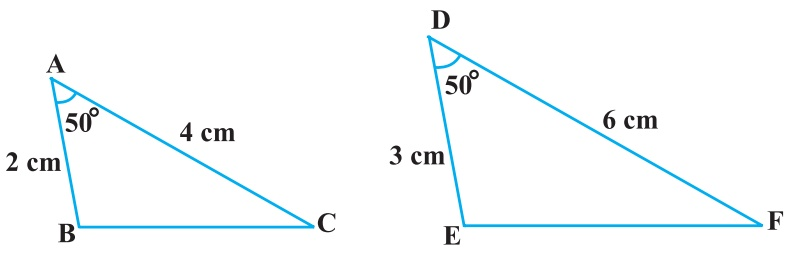
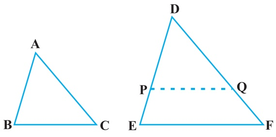

Fig. 6.27

Here, you may observe that ${ \frac { \mathrm { A B } } { \mathrm { D E } } }   =   { \frac { \mathrm { A C } } { \mathrm { D F } } }$ (each equal to $\frac { 2 } { 3 } )$ and $\angle \mathrm { A }$ (included between the sides AB and $\mathrm { A C )   =   \angle D }$ (included between the sides DE and DF). That is, one angle of a triangle is equal to one angle of another triangle and sides including these angles are in the same ratio (i.e., proportion). Now let us measure $\angle \mathrm { B } , \angle \mathrm { C } ,$ $\angle \mathrm { E } { \mathrm { ~ a n d ~ } } \angle \mathrm { F } .$

You will find that $\angle \mathrm{B} = \angle \mathrm{E}$ and $\angle C = \angle F$ That is, $\angle \mathrm{A} = \angle \mathrm{D}, \angle \mathrm{B} = \angle \mathrm{E}$ and $\angle C = \angle  F. So$ , by AAA similarity criterion, $\Delta  ABC  \sim \Delta  DEF$ You may repeat this activity by drawing several pairs of such triangles with one angle of a triangle equal to one angle of another triangle and the sides including these angles are proportional. Everytime, you will find that the triangles are similar. It is due to the following criterion of similarity of triangles:

**Theorem 6.5 :** If one angle of a triangle is equal to one angle of the other triangle and the sides including these angles are proportional, then the two triangles are similar.

This criterion is referred to as the SAS (Side–Angle–Side) s i m i l a r i t y c r i t e r i o n fo r t w o triangles.

As before, this theorem can be proved by taking two triangles ABC and DEF such that $\frac{ AB }{ DE } = \frac{ AC }{ DF } \quad (< 1)   and   \angle  A  = \angle  D$ (see Fig. 6.28). Cut $\mathrm { D P } = \mathrm { A B }$ , DQ $= \mathrm { A C }$ and join PQ.

Fig. 6.28