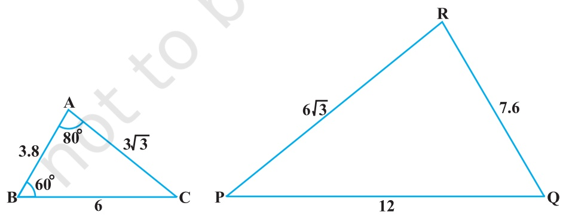
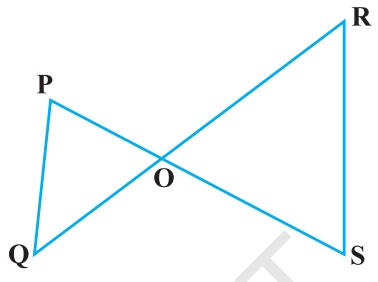

Fig. 6.30

Now, $\mathrm { P Q } \parallel \mathrm { E F }   \mathrm { a n d }   \Delta   \mathrm { A B C } \cong \Delta   \mathrm { D P Q }$ (How ?)

So, $\angle \mathrm{A} = \angle \mathrm{D}, \angle \mathrm{B} = \angle \mathrm{P}   and   \angle \mathrm{C} = \angle \mathrm{Q}$

Therefore, $\Delta   \mathrm { A B C } \sim \Delta   \mathrm { D E F }$ (Why?)

We now take some examples to illustrate the use of these criteria.

Example 4 : In Fig. 6.29, if PQ ∥ RS, prove that ∆ POQ ∼ ∆ SOR.

Fig. 6.29

Solution : $\mathrm { P Q } \parallel \mathrm { R S }$

So, $\angle \mathrm{P} = \angle \mathrm{S}$

(Alternate angles)

and $\angle Q = \angle R$

Also, $\angle POQ = \angle SOR$ (Vertically opposite angles)

Therefore, $\Delta  POQ  \sim \Delta  SOR$

(AAA similarity criterion)

Example 5 : Observe Fig. 6.30 and then find $\angle \mathrm { P } .$

Solution : In ∆ ABC and ∆ PQR,