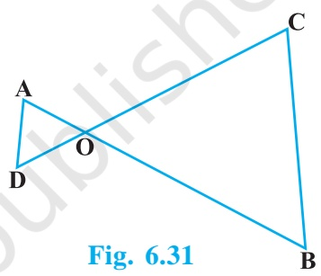
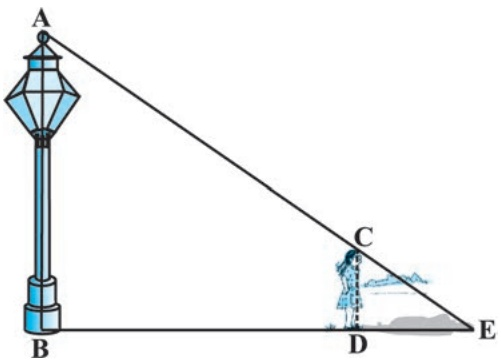

$$
\frac{\mathrm{AB}}{\mathrm{RQ}}=\frac{3.8}{7.6}=\frac{1}{2}, \frac{\mathrm{BC}}{\mathrm{QP}}=\frac{6}{12}=\frac{1}{2} \text { and } \frac{\mathrm{CA}}{\mathrm{PR}}=\frac{3 \sqrt{3}}{6 \sqrt{3}}=\frac{1}{2}
$$

That is,

$$
\frac{\mathrm{AB}}{\mathrm{RQ}}=\frac{\mathrm{BC}}{\mathrm{QP}}=\frac{\mathrm{CA}}{\mathrm{PR}}
$$

So,

$$
\Delta   \mathrm { A B C } \sim \Delta   \mathrm { R Q P }
$$

(SSS similarity)

Therefore,

$$
\angle C = \angle  P
$$

(Corresponding angles of similar triangles)

But

$$
\angle C = 180^{\circ} - \angle A - \angle B
$$

(Angle sum property)

$$
=   180^{\circ} - 80^{\circ} - 60^{\circ} = 40^{\circ}
$$

So,

$$
\angle \mathrm { P } = 4 0 ^ { \circ }
$$

**Example 6 :** In Fig. 6.31,

$$
OA. OB = OC. OD.
$$

Show that $\angle \mathrm{A} = \angle \mathrm{C}   and   \angle \mathrm{B} = \angle \mathrm{D}.$

**Solution :** $OA. OB = OC. OD$ (Given)

So,

$$
\frac{OA}{OC} = \frac{OD}{OB}\tag{1}
$$

Also, we have

$\angle AOD = \angle COB$ (Vertically opposite angles) (2)

Therefore, from (1) and (2), $\Delta  AOD  \sim \Delta  COB$ (SAS similarity criterion)

So,

$\angle A = \angle C$ and $\angle \mathrm{D} = \angle \mathrm{B}$ (Corresponding angles of similar triangles)

**Example 7 :** A girl of height 90 cm is walking away from the base of a lamp-post at a speed of 1.2 m/s. If the lamp is 3.6 m above the ground, find the length of her shadow after 4 seconds.

**Solution :** Let AB denote the lamp-post and CD the girl after walking for 4 seconds away from the lamp-post (see Fig. 6.32).

From the figure, you can see that DE is the shadow of the girl. Let DE be x metres.

Fig. 6.32