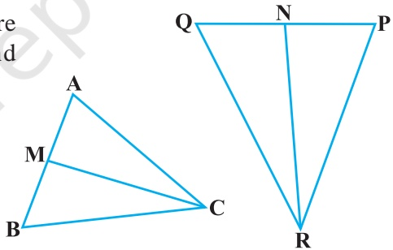

Now, $BD = 1.2\  m  \times 4 = 4.8\  m$

Note that in $\Delta   \mathrm { A B E }$ and $\Delta   \mathrm { C D E }$

∠B = ∠D (Each is of $9 0 ^ { \circ }$ because lamp-post as well as the girl are standing vertical to the ground)

and

$$
\angle \mathrm{E} = \angle \mathrm{E}\tag{Same angle}
$$

So,

$$
\Delta   \mathrm { A B E } \sim \Delta   \mathrm { C D E }
$$

(AA similarity criterion)

Therefore,

$$
\left[ { \frac { \mathrm { B E } } { \mathrm { D E } } }   =   { \frac { \mathrm { A B } } { \mathrm { C D } } } \right]
$$

i.e.,

$$
\left[ \frac{4.8 + x}{x} = \frac{3.6}{0.9} \right]
$$

$$
90\  cm  = \frac{90}{100}\  m  = 0.9\  m
$$

i.e.,

$$
4 . 8 \pm x = 4 x
$$

i.e.,

$$
3x = .4.8
$$

i.e.,

$$
x \equiv 1 . 6
$$

So, the shadow of the girl after walking for 4 seconds is 1.6 m long.

**Example 8 :** In Fig. 6.33, CM and RN are respectively the medians of $\Delta$ ABC and $\Delta$ PQR. If $\Delta  ABC  \sim \Delta  PQR$ , prove that :

(i) $\Delta   \mathrm { A M C } \sim \Delta   \mathrm { P N R }$

(ii) $\frac { \mathrm { C M } } { \mathrm { R N } }   =   \frac { \mathrm { A B } } { \mathrm { P Q } }$

(iii) $\Delta \mathrm { C M B } \sim \Delta \mathrm { R N Q }$

**Solution :** (i)

$$
\Delta  ABC  \sim \Delta  PQR
$$

Fig. 6.33

(Given)

So,

$$
\frac{\mathrm{AB}}{\mathrm{PQ}}=\frac{\mathrm{BC}}{\mathrm{QR}}=\frac{\mathrm{CA}}{\mathrm{RP}}\tag{1}
$$

and

$$
\angle \mathrm{A} = \angle \mathrm{P}, \angle \mathrm{B} = \angle \mathrm{Q}   and   \angle \mathrm{C} = \angle \mathrm{R}
$$

But

$$
AB = 2\  AM \  and \  PQ  = 2\  PN\tag{2}
$$

(As CM and RN are medians)

So, from (1),

$$
\frac{2 AM }{2 PN } = \frac{ CA }{ RP }
$$