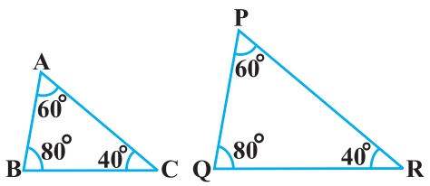
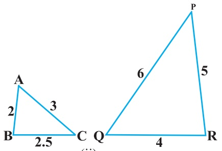
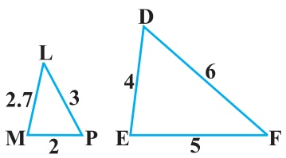
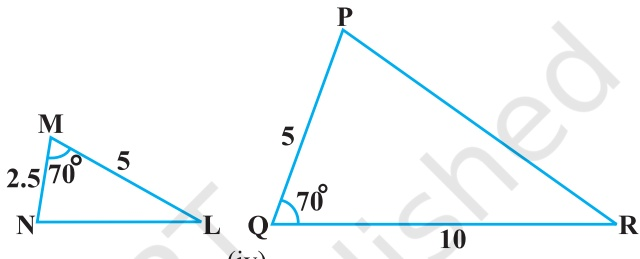
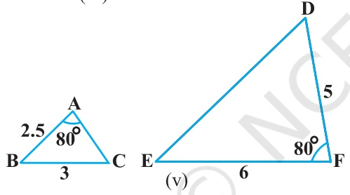
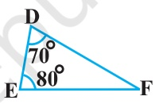
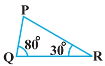
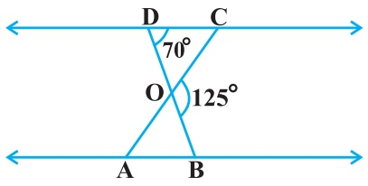

(i)

(ii)

(iv)

(iii)

(vi)

Fig. 6.34

2. In Fig. $6.35,\Delta  ODC \sim \Delta  OBA ,\angle  BOC = 125^{\circ}$ and $\angle CDO = 70^{\circ}$ . Find $\angle  DOC , \angle  DCO$ and $\angle \mathrm { O A B }$

**3.** Diagonals AC and BD of a trapezium ABCD with AB || DC intersect each other at the point O. Using a similarity criterion for two triangles, show that $\frac { \mathrm { O A } } { \mathrm { O C } }   =   \frac { \mathrm { O B } } { \mathrm { O D } }$

Fig. 6.35