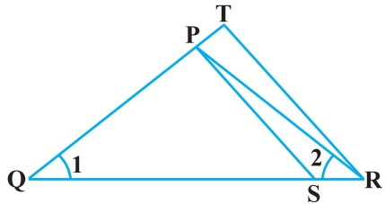
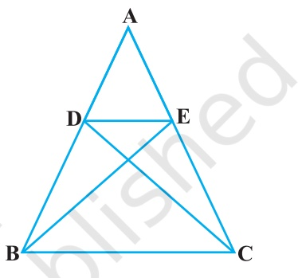
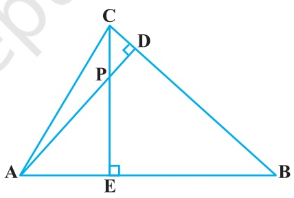
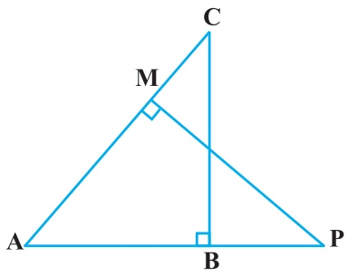

4. In Fig. 6.36, $\frac { \mathrm { Q R } } { \mathrm { Q S } } = \frac { \mathrm { Q T } } { \mathrm { P R } }$ and $\angle 1 = \angle 2$ .Show that $\Delta \operatorname { P Q S } \sim \Delta$ TQR.

5. S and T are points on sides PR and QR of ∆ PQR such that $\angle \mathrm{P} = \angle \mathrm{RTS}$ . Show that $\Delta \mathrm { R P Q } \sim \Delta \mathrm { R T S }$

6. In Fig. 6.37, if $\Delta \; \mathrm { A B E } \cong \Delta \; \mathrm { A C D }$ , show that $\Delta  ADE  \sim \Delta  ABC$

7. In Fig. 6.38, altitudes AD and CE of ∆ ABC intersect each other at the point P. Show that:

(i) $\Delta  AEP  \sim \Delta  CDP$

(ii) $\Delta  ABD  \sim \Delta  CBE$

(iii) $\Delta  AEP  \sim \Delta  ADB$

(iv) $\Delta \mathrm { P D C } \sim \Delta \mathrm { B E C }$

8. E is a point on the side AD produced of a parallelogram ABCD and BE intersects CD at F. Show that $\Delta \mathrm { A B E } \sim \Delta \mathrm { C F B }$

9. In Fig. 6.39, ABC and AMP are two right triangles, right angled at B and M respectively. Prove that:

(i) $\Delta  ABC  \sim \Delta  AMP$

(ii) $\frac { \mathrm { C A } } { \mathrm { P A } }   =   \frac { \mathrm { B C } } { \mathrm { M P } }$

10. CD and GH are respectively the bisectors of $\angle ACB   and   \angle EGF$ such that D and H lie on sides AB and FE of ∆ ABC and ∆ EFG respectively. $\mathrm{If} \Delta \mathrm{ABC} \sim \Delta \mathrm{FEG}.$ show that: (i) $\frac { \mathrm { C D } } { \mathrm { G H } } = \frac { \mathrm { A C } } { \mathrm { F G } }$ (ii) $\Delta  DCB  \sim \Delta  HGE$ (iii) $\Delta \mathrm { D C A }   \sim   \Delta \mathrm { H G F }$

Fig. 6.36

Fig. 6.37

Fig. 6.38

Fig. 6.39