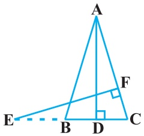
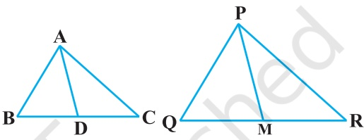

**11.** In Fig. 6.40, E is a point on side CB produced of an isosceles triangle ABC with AB = AC. If AD ⊥ BC and EF ⊥AC, prove that $\Delta \mathrm { A B D } \sim \Delta \mathrm { E C F } .$

**12.** Sides AB and BC and median AD of a triangle ABC are respectively proportional to sides PQ and QR and median PM of   PQR (see Fig. 6.41). Show that $\Delta  ABC  \sim \Delta  PQR$

Fig. 6.40

**13.** D is a point on the side BC of a triangle ABC such that $\angle ADC = \angle BAC$ . Show that $CA^{2}=CB.CD$

**14.** Sides AB and AC and median AD of a triangle ABC are respectively proportional to sides PQ and PR and median PM of another triangle PQR. Show that $\Delta \mathrm { A B C } \sim \Delta \mathrm { P Q R }$

Fig. 6.41

**15.** A vertical pole of length 6 m casts a shadow 4 m long on the ground and at the same time a tower casts a shadow 28 m long. Find the height of the tower.

**16.** If AD and PM are medians of triangles ABC and PQR, respectively where $\Delta \mathrm { A B C } \sim \Delta \mathrm { P Q R }$ , prove that $\frac{\overline{AB}}{\overline{PQ}} = \frac{\overline{AD}}{\overline{PM}}$

## 6.5 Summary

In this chapter you have studied the following points :

**1.** Two figures having the same shape but not necessarily the same size are called similar figures.

**2.** All the congruent figures are similar but the converse is not true.

**3.** Two polygons of the same number of sides are similar, if (i) their corresponding angles are equal and (ii) their corresponding sides are in the same ratio (i.e., proportion).

**4.** If a line is drawn parallel to one side of a triangle to intersect the other two sides in distinct points, then the other two sides are divided in the same ratio.

**5.** If a line divides any two sides of a triangle in the same ratio, then the line is parallel to the third side.

**6.** If in two triangles, corresponding angles are equal, then their corresponding sides are in the same ratio and hence the two triangles are similar (AAA similarity criterion).

**7.** If in two triangles, two angles of one triangle are respectively equal to the two angles of the other triangle, then the two triangles are similar (AA similarity criterion).