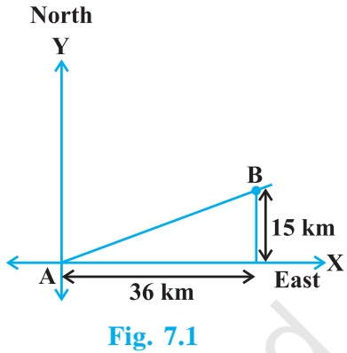
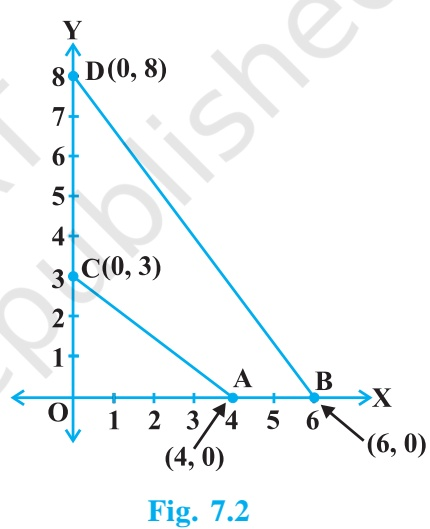

## 7.2 Distance Formula

Let us consider the following situation:

A town B is located 36 km east and 15 km north of the town A. How would you find the distance from town A to town B without actually measuring it. Let us see. This situation can be represented graphically as shown in Fig. 7.1. You may use the Pythagoras Theorem to calculate this distance.

Now, suppose two points lie on the x-axis. Can we find the distance between them? For instance, consider two points A(4, 0) and B(6, 0) in Fig. 7.2. The points A and B lie on the x-axis.

From the figure you can see that $\mathrm { O A } = 4$ units and $\mathrm { O B } = 6$ units.

Therefore, the distance of B from A, i.e., $\mathrm{AB} = \mathrm{OB} - \mathrm{OA} = 6 - 4 = 2$ units.

So, if two points lie on the x-axis, we can easily find the distance between them.

Now, suppose we take two points lying on the y-axis. Can you find the distance between them. If the points $C(0,3)$ and D(0, 8) lie on the y-axis, similarly we find that $CD = 8 - 3 = 5$ units (see Fig. 7.2).

Next, can you find the distance of A from C (in Fig. 7.2)? Since OA = 4 units and OC = 3 units, the distance of A from C, i.e., $\mathrm{AC} = \sqrt{3^{2} + 4^{2}} = 5$ units. Similarly, you can find the distance of B from $\mathrm { D } = \mathrm { B D } = 1 0$ units.

Now, if we consider two points not lying on coordinate axis, can we find the distance between them? Yes! We shall use Pythagoras theorem to do so. Let us see an example.

In Fig. 7.3, the points P(4, 6) and Q(6, 8) lie in the first quadrant. How do we use Pythagoras theorem to find the distance between them? Let us draw PR and QS perpendicular to the x-axis from P and Q respectively. Also, draw a perpendicular from P on QS to meet QS at T. Then the coordinates of R and S are (4, 0) and (6, 0), respectively. So, RS = 2 units. Also, QS = 8 units and $\mathrm{TS} = \mathrm{PR} = 6$ units.