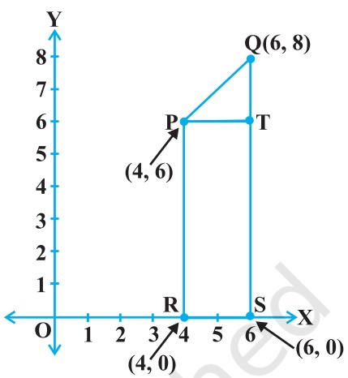
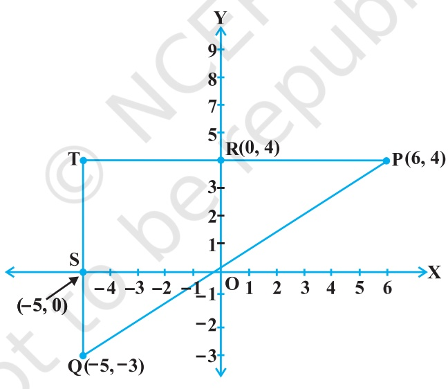

Therefore, QT = 2 units and $\mathrm{PT} = \mathrm{RS} = 2$ units.

Now, using the Pythagoras theorem, we have

$$
\begin{aligned} PQ ^{2} = &  PT ^{2} +  OT ^{2} \\= & 2^{2} + 2^{2} = 8.\end{aligned}
$$

So,

$$
PQ = \sqrt[r]{2}   units
$$

How will we find the distance between two points in two different quadrants?

Consider the points P(6, 4) and Q(–5, –3) (see Fig. 7.4). Draw QS perpendicular to the x-axis. Also draw a perpendicular PT from the point P on QS (extended) to meet y-axis at the point R.

Fig. 7.3

Fig. 7.4

Then PT = 11 units and QT = 7 units. (Why?)

Using the Pythagoras Theorem to the right triangle PTQ, we get $PQ = \sqrt{11^{2} + 7^{2}} = \sqrt{170}$ units.