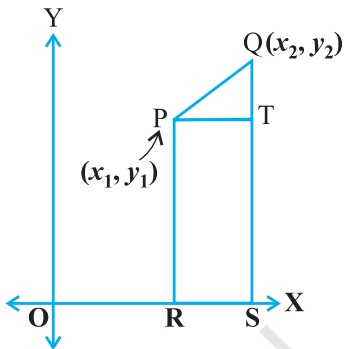

Let us now find the distance between any two points $\mathrm { P } ( \boldsymbol { x } _ { 1 } , \boldsymbol { y } _ { 1 } )$ and $\mathbb { Q } ( \boldsymbol { x } _ { 2 } , \boldsymbol { y } _ { 2 } )$ . Draw PR and QS perpendicular to the x-axis. A perpendicular from the point P on QS is drawn to meet it at the point T (see Fig. 7.5).

Then, $\mathrm{OR}=x_{1}, \mathrm{OS}=x_{2}. \quad \mathrm{So}, \quad \mathrm{RS}=x_{2}-x_{1}=\mathrm{PT}.$

Also, $\mathrm{SQ} = y_{2}, \quad \mathrm{ST} = \mathrm{PR} = y_{1}.$ So, $\mathrm { Q T } = \boldsymbol { y } _ { 2 } - \boldsymbol { y } _ { 1 } .$

Now, applying the Pythagoras theorem in $\Delta   \mathrm { P T Q } ,$ we get

Therefore,

$$
\begin{aligned} PQ ^{2} &=  PT ^{2} +  Q  T ^{2} \\&= (x_{_2} - x_{_1})^{2} + (y_{_2} - y_{_1})^{2} \\ PQ  &= \sqrt{\left(x_{_2} - x_{_1}\right)^{2} + \left(y_{_2} - \underline{y}_{_1}\right)^{2}}\end{aligned}
$$

Fig. 7.5

Note that since distance is always non-negative, we take only the positive square root. So, the distance between the points $\mathrm{P}(x_1, y_1)$ and $\mathrm{Q}(x_{2},\overline{y}_{2})$ is

$$
\mathrm{PQ} = \sqrt{\left( x_{2} - x_{1} \right)^{2} + \left( y_{2} - y_{1} \right)^{2}}
$$

which is called the **distance formula**.

## Remarks :

1. In particular, the distance of a point $\mathrm { P } ( x , { \hat { y } } )$ from the origin O(0, 0) is given by

$$
\mathrm{OP} = \sqrt{x^{2} + y^{2}}
$$

2. We can also write, $\mathrm{PQ} = \sqrt{\left(x_{1} - x_{2}\right)^{2} + \left(y_{1} - y_{2}\right)^{2}}$

**Example 1 :** Do the points $(3,2),(-2,-3)$ and (2, 3) form a triangle? If so, name the type of triangle formed.

**Solution :** Let us apply the distance formula to find the distances PQ, QR and PR, where $P(3,2),Q(-2,-3)$ and R(2, 3) are the given points. We have

$$
\mathrm{PQ} = \sqrt{(3 + 2)^2 + (2 + 3)^2} = \sqrt{5^2 + 5^2} = \sqrt{50} = 7.07   (\mathrm{appmax.})
$$

$$
\mathrm{QR} = \sqrt{(-2-2)^2 + (-3-3)^2} = \sqrt{(-4)^2 + (-6)^2} = \sqrt{52} = 7.21 (\mathrm{appox.})
$$

$$
\mathrm{PR} = \sqrt{(3 - 2)^2 + (2 - 3)^2} = \sqrt{1^2 + (-1)^2} = \sqrt{2} = 1.41 (\mathrm{appmax.})
$$

Since the sum of any two of these distances is greater than the third distance, therefore, the points P, Q and R form a triangle.