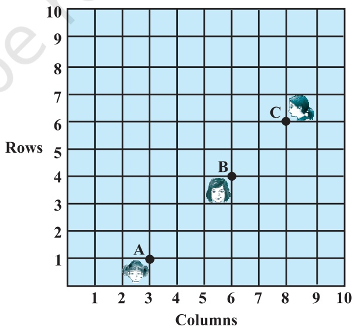

Also, $\mathrm{PQ}^{2}+\mathrm{PR}^{2}=\mathrm{QR}^{2}$ , by the converse of Pythagoras theorem, we have $\angle \mathrm { P } = 9 0 ^ { \circ }$ Therefore, PQR is a right triangle.

**Example 2 :** Show that the points (1, 7), (4, 2), (–1, –1) and $( - 4 , 4 )$ are the vertices of a square.

**Solution :** Let A(1, 7), B(4, 2), C(–1, –1) and $\mathrm { D } ( - 4 , 4 )$ be the given points. One way of showing that ABCD is a square is to use the property that all its sides should be equal and both its digonals should also be equal. Now,

$$
\mathrm{AB} = \sqrt{(1 - 4)^{2} + (7 - 2)^{2}} = \sqrt{9 + 25} = \sqrt{34}
$$

$$
\mathrm{BC} = \sqrt{(4 + 1)^2 + (2 + 1)^2} = \sqrt{25 + 9} = \sqrt{34}
$$

$$
CD =\sqrt{\left(-1+4\right)^{2}+\left(-1-4\right)^{2}}=\sqrt{9+25}=\sqrt{34}
$$

$$
\mathrm{DA}=\sqrt{(1+4)^{2}+(7-4)^{2}}=\sqrt{25+9}=\sqrt{34}
$$

$$
\mathrm{AC} = \sqrt{(1 + 1)^{2} + (7 + 1)^{2}} = \sqrt{4 + 64} = \sqrt{68}
$$

$$
\mathrm{BD} = \sqrt{(4 + 4)^2 + (2 - 4)^2} = \sqrt{64 + 4} = \sqrt{68}
$$

Since, $\mathrm{AB} = \mathrm{BC} = \mathrm{CD} = \mathrm{DA}$ and $AC  \equiv  BD$ , all the four sides of the quadrilateral ABCD are equal and its diagonals AC and BD are also equal. Thereore, ABCD is a square.

**Alternative Solution :** We find the four sides and one diagonal, say, AC as above. Here $AD^{2} + DC^{2} =$ $34+34=68=AC^{2}$ . Therefore, by the converse of Pythagoras theorem, $\angle \mathrm{D} = 90^{\circ}$ . A quadrilateral with all four sides equal and one angle $9 0 ^ { \circ }$ is a square. So, ABCD is a square.

**Example 3 :** Fig. 7.6 shows the arrangement of desks in a classroom. Ashima, Bharti and Camella are seated at A(3, 1), B(6, 4) and C(8, 6) respectively. Do you think they are seated in a line? Give reasons for your answer.

Fig. 7.6