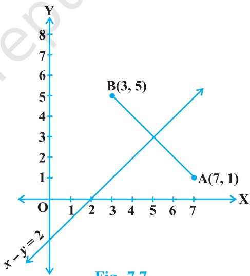

**Solution :** Using the distance formula, we have

$$
AB = \sqrt{\left(6-3\right)^{2}+\left(4-1\right)^{2}}=\sqrt{9+9}=\sqrt{18}=3\sqrt{2}.
$$

$$
\mathrm{BC} = \sqrt{\left( 8 - 6 \right)^{2} + \left( 6 - 4 \right)^{2}} = \sqrt{4 + 4} = \sqrt{8} = 2\sqrt{2}
$$

$$
AC  = \sqrt{ \left( 8 - 3 \right)^{2} + \left( 6 - 1 \right)^{2} } = \sqrt{ 25 + 25 } = \sqrt{ 50 } = 5\sqrt{ 2 }
$$

Since, $AB + BC = 3\sqrt{2} + 2\sqrt{2} = 5\sqrt{2} = AC$ ,  we can say that the points A, B and C are collinear. Therefore, they are seated in a line.

**Example 4 :** Find a relation between x and y such that the point (x , y) is equidistant from the points (7, 1) and (3, 5).

**Solution :** Let $\mathrm { P } ( x , y )$ be equidistant from the points A(7, 1) and B(3, 5).

We are given that $\mathrm{AP} = \mathrm{BP}. \mathrm{So}, \mathrm{AP}^2 = \mathrm{BP}^2$

i.e.,

$$
(x - 7)^{2} + (y - 1)^{2} = (x - 3)^{2} + (y - 5)^{2}
$$

i.e.,

$$
x^{2}-14x+49+y^{2}-2y+1=x^{2}-6x+9+y^{2}-10y+25
$$

i.e.,

$$
x - y = 2
$$

which is the required relation.

**Remark :** Note that the graph of the equation $x - y = 2$ is a line. From your earlier studies, you know that a point which is equidistant from A and B lies on the perpendicular bisector of AB. Therefore, the graph of $x - y = 2$ is the perpendicular bisector of AB (see Fig. 7.7).

**Example 5 :** Find a point on the y-axis which is equidistant from the points $\mathrm { A } ( 6 ,   5 )$ and B(– 4, 3).

**Solution :** We know that a point on the y-axis is of the form (0, y). So, let the point $\mathrm { P } ( 0 , y )$ be equidistant from A and B. Then

Fig. 7.7

$$
( 6 - 0 ) ^ { 2 } + ( 5 - y ) ^ { 2 } = ( - 4 - 0 ) ^ { 2 } + ( 3 - y ) ^ { 2 }
$$

i.e.,

$$
36+25+y^{2}-10y=16+9+y^{2}-6y
$$

i.e.,

$$
4 y = 3 6
$$

i.e.,

$$
y = 9
$$