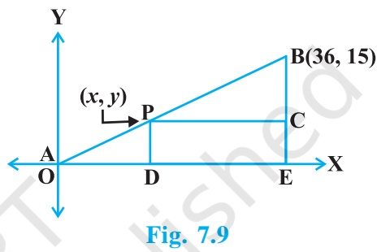
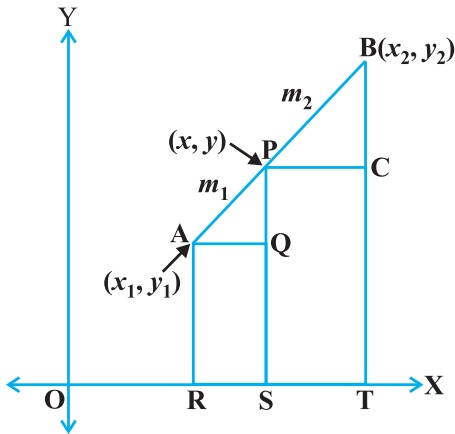

**9.** If Q(0, 1) is equidistant from $\mathrm{P}(5, -3)$ and $\mathrm { R } ( x ,   6 )$ , find the values of x. Also find the distances QR and PR.

**10.** Find a relation between x and y such that the point $( x , y )$ is equidistant from the point (3, 6) and (– 3, 4).

## 7.3 Section Formula

Let us recall the situation in Section 7.2. Suppose a telephone company wants to position a relay tower at P between A and B is such a way that the distance of the tower from B is twice its distance from A. If P lies on AB, it will divide AB in the ratio 1 : 2 (see Fig. 7.9). If we take A as the origin O, and 1 km as one unit on both the axis, the coordinates of B will be (36, 15). In order to know the position of the tower, we must know the coordinates of P. How do we find these coordinates?

Let the coordinates of P be $( x ,   y )$ Draw perpendiculars from P and B to the x-axis, meeting it in D and E, respectively. Draw PC perpendicular to BE. Then, by the AA similarity criterion, studied in Chapter 6,   POD and $\Delta   \mathrm { B P C }$ are similar.

Therefore , $\frac{OD}{PC} = \frac{OP}{PB} = \frac{1}{2}$ , and $\frac{\mathrm{PD}}{\mathrm{BC}} = \frac{\mathrm{OP}}{\mathrm{PB}} = \frac{1}{2}$

So, $\frac { x } { 3 6   -   x }   =   \frac { 1 } { 2 }$ and $\frac{y}{15 - y} \div \frac{1}{2}$

These equations give $x = 1 2$ and $y = 5$

You can check that P(12, 5) meets the condition that $\mathrm{OP}:\mathrm{PB}=1:2$

Now let us use the understanding that you may have developed through this example to obtain the general formula.

Consider any two points $\mathrm { A } ( x _ { 1 } , y _ { 1 } )$ and $\mathbf { B } ( x _ { _ 2 } ,   y _ { _ 2 } )$ and assume that $\mathrm { ~ P ~ } ( x ,   y )$ divides AB internally in the ratio $m _ { _ 1 } : m _ { _ 2 } ,$ i.e., $\frac { \mathrm { P A } } { \mathrm { P B } }   =   \frac { m _ { 1 } } { m _ { 2 } }$ (see Fig. 7.10).

Fig. 7.10