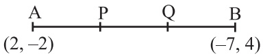

Therefore, the point (– 4, 6) divides the line segment joining the points A(– 6, 10) and B(3, – 8) in the ratio 2 : 7.

**Alternatively :** The ratio $m _ { _ 1 } : m _ { _ 2 }$ can also be written as $\frac { m _ { 1 } } { m _ { 2 } } \colon 1 ,$ , or k : 1. Let (– 4, 6) divide AB internally in the ratio k : 1. Using the section formula, we get

$$
(-4,6)=\left(\frac{3k-6}{k+1},\frac{-8k+10}{k+1}\right)\tag{2}
$$

So,

$$
-   4 =   { \frac { 3 k - 6 } { k + 1 } }
$$

i.e.,

$$
-4k-4=3k-6
$$

i.e.,

$$
7 k = 2
$$

i.e.,

$$
k : 1 = 2 : 7
$$

You can check for the y-coordinate also.

So, the point (– 4, 6) divides the line segment joining the points A(– 6, 10) and B(3, – 8) in the ratio 2 : 7.

**Note :** You can also find this ratio by calculating the distances PA and PB and taking their ratios provided you know that A, P and B are collinear.

**Example 8 :** Find the coordinates of the points of trisection (i.e., points dividing in three equal parts) of the line segment joining the points A(2, – 2) and B(– 7, 4).

**Solution :** Let P and Q be the points of trisection of AB i.e., $\mathrm{AP} = \mathrm{PQ} = \mathrm{QB}$ (see Fig. 7.11).

Fig. 7.11

Therefore, P divides AB internally in the ratio 1 : 2. Therefore, the coordinates of P, by applying the section formula, are

$$
\left( \frac{1(-7)+2(2)}{1+2}, \frac{1(4)+2(-2)}{1+2} \right), \mathrm{i.e.}, (-1,0)
$$

Now, Q also divides AB internally in the ratio 2 : 1. So, the coordinates of Q are

$$
\left( \frac{2(-7)+1(2)}{2+1}, \frac{2(4)+1(-2)}{2+1} \right), \mathrm{i.e.}, (-4, 2)
$$