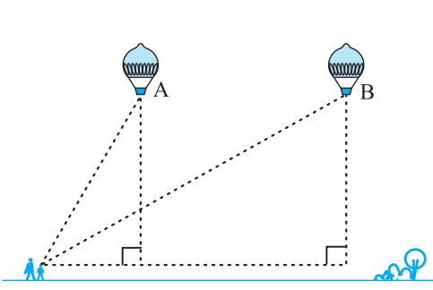
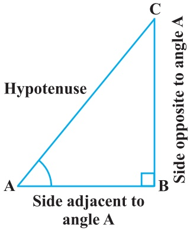

3. Suppose a hot air balloon is flying in the air. A girl happens to spot the balloon in the sky and runs to her mother to tell her about it. Her mother rushes out of the house to look at the balloon.Now when the girl had spotted the balloon intially it was at point A. When both the mother and daughter came out to see it, it had already travelled to another point B. Can you find the altitude of B from the ground?

Fig. 8.3

In all the situations given above, the distances or heights can be found by using some mathematical techniques, which come under a branch of mathematics called ‘trigonometry’. The word ‘trigonometry’ is derived from the Greek words ‘tri (meaning three), ‘gon’ (meaning sides) and ‘metron’ (meaning measure). In fact, **trigonometry** is the study of relationships between the sides and angles of a triangle. The earliest known work on trigonometry was recorded in Egypt and Babylon. Early astronomers used it to find out the distances of the stars and planets from the Earth. Even today, most of the technologically advanced methods used in Engineering and Physical Sciences are based on trigonometrical concepts.

In this chapter, we will study some ratios of the sides of a right triangle with respect to its acute angles, called **trigonometric ratios of the angle.** We will restrict our discussion to acute angles only. However, these ratios can be extended to other angles also. We will also define the trigonometric ratios for angles of measure $0 ^ { \circ }$ and 90°. We will calculate trigonometric ratios for some specific angles and establish some identities involving these ratios, called **trigonometric identities.**

## 8.2 Trigonometric Ratios

In Section 8.1, you have seen some right triangles imagined to be formed in different situations.

Let us take a right triangle ABC as shown in Fig. 8.4.

Here, $\angle \mathrm { C A B }$ (or, in brief, angle A) is an acute angle. Note the position of the side BC with respect to angle A. It faces $\mathrm { \angle A }$ . We call it the side opposite to angle A. AC is the hypotenuse of the right triangle and the side AB is a part of $\angle \textrm { A }$ . So, we call it the side adjacent to angle A.

Fig. 8.4