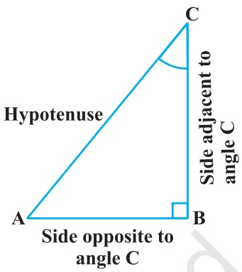

Note that the position of sides change when you consider angle C in place of A (see Fig. 8.5).

You have studied the concept of ‘ratio’ in your earlier classes. We now define certain ratios involving the sides of a right triangle, and call them trigonometric ratios.

**The trigonometric ratios** of the angle A in right triangle ABC (see Fig. 8.4) are defined as follows :

Fig. 8.5

$$
\mathrm{sine~of~\angle A} = \frac{\mathrm{side~opposite~to~angle~A}}{\mathrm{hypotenuse}} = \frac{\mathrm{BC}}{\mathrm{AC}}
$$

$$
\mathrm{cosine\ of\ \angle A=\frac{side\ adjacent\ to\ angle\ A}{hypotenuse}=\frac{AB}{AC}}
$$

$$
\mathrm{tangent of} \angle \mathrm{A}=\frac{\mathrm{side opposite to angle}}{\mathrm{side adjacent to angle}}=\frac{\mathrm{BC}}{\mathrm{AB}}
$$

$$
\mathrm{cosecant of} \angle \mathrm{A}=\frac{1}{\mathrm{sine of} \angle \mathrm{A}}=\frac{\mathrm{hypot} \bar{\mathrm{s}} \mathrm{a} \mathrm{s}}{\mathrm{side} opposite to a�除 \mathrm{A}}=\frac{\mathrm{AC}}{\mathrm{BC}}
$$

$$
\mathrm{sccant~of~ \angle A} = \frac{1}{\mathrm{cosine~of~ \angle A}} = \frac{\mathrm{hypotenuse}}{\mathrm{side~adjacent~to~angle~A}} = \frac{\mathrm{AC}}{\mathrm{AB}}
$$

cotangent of $\angle \mathrm{A} = \frac{1}{1   agent of   \angle \mathrm{A}} = \frac{ side adjacent to angle   \mathrm{A}}{ side opposite to angle   \mathrm{A}} = \frac{\mathrm{AB}}{\mathrm{BC}}$

The ratios defined above are abbreviated as sin A, cos A, tan A, cosec A, sec A and cot A respectively. Note that the ratios **cosec A, sec A and cot A** are respectively, the reciprocals of the ratios sin A, cos A and tan A.

Also, observe that tan $\frac{BC}{AB} = \frac{\frac{BC}{AC}}{\frac{AB}{AC}} = \frac{\sin A}{\cos A}$ and cot $\mathrm { A } = { \frac { \cos \mathrm { A } } { \sin \mathrm { A } } }$

So, the **trigonometric ratios** of an acute angle in a right triangle express the relationship between the angle and the length of its sides.

Why don’t you try to define the trigonometric ratios for angle C in the right triangle? (See Fig. 8.5)