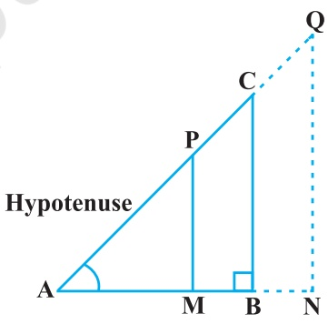

The first use of the idea of **‘sine’** in the way we use it today was in the work Aryabhatiyam by Aryabhata, in A.D. 500. Aryabhata used the word **ardha-jya** for the half-chord, which was shortened to **jya** or **jiva** in due course. When the Aryabhatiyam was translated into Arabic, the word **jiva** was retained as it is. The word **jiva** was translated into **sinus,** which means curve, when the Arabic version was translated into Latin. Soon the word **sinus**, also used as **sine**, became common in mathematical texts throughout Europe. An English Professor of astronomy Edmund Gunter (1581–1626), first used the abbreviated notation **‘sin’.**

Aryabhata C.E. 476 – 550

The origin of the terms **‘cosine’** and **‘tangent’** was much later. The cosine function arose from the need to compute the sine of the complementary angle. Aryabhatta called it **kotijya**. The name **cosinus** originated with Edmund Gunter. In 1674, the English Mathematician Sir Jonas Moore first used the abbreviated notation **‘cos’**.

**Remark :** Note that the symbol sin A is used as an abbreviation for ‘the sine of the angle A’. sin A is not the product of ‘sin’ and A. ‘sin’ separated from A has no meaning. Similarly, cos A is not the product of ‘cos’ and A. Similar interpretations follow for other trigonometric ratios also.

Now, if we take a point P on the hypotenuse AC or a point Q on AC extended, of the right triangle ABC and draw PM perpendicular to AB and QN perpendicular to AB extended (see Fig. 8.6), how will the trigonometric ratios of $\angle \mathrm { A }$ in $\Delta$ PAM differ from those of $\angle \mathrm { A }$ in $\Delta$ CAB or from those of $\mathrm { \angle A }$ in $\Delta$ QAN?

Fig. 8.6

To answer this, first look at these triangles. Is   PAM similar to $\Delta$ CAB? From Chapter 6, recall the AA similarity criterion. Using the criterion, you will see that the triangles PAM and CAB are similar. Therefore, by the property of similar triangles, the corresponding sides of the triangles are proportional.

So, we have

$$
\frac{ AM }{ AB } = \frac{AP}{ AC } = \frac{MP}{ BC }
$$