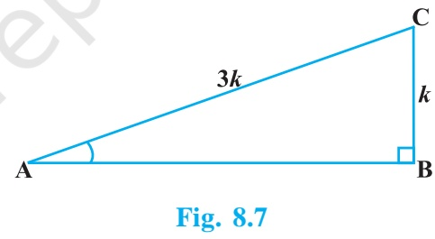

From this, we find

$$
\frac{\mathrm{MP}}{\mathrm{AP}}=\frac{\mathrm{BC}}{\mathrm{AC}}=\sin\mathrm{A}
$$

Similarly,

$$
\frac{AM}{AP}=\frac{AB}{AC}=\cos A,\frac{MP}{AM}=\frac{BC}{AB}=\tan A and so on.
$$

This shows that the trigonometric ratios of angle A in   PAM not differ from those of angle A in $\Delta   \mathrm { C A B }$

In the same way, you should check that the value of sin A (and also of other trigonometric ratios) remains the same in   QAN also.

From our observations, it is now clear that **the values of the trigonometric ratios of an angle do not vary with the lengths of the sides of the triangle, if the angle remains the same.**

**Note :** For the sake of convenience, we may write sin2A, cos2A, etc., in place of (sin $\mathrm { A ) ^ { 2 } }$ , (cos $\mathrm { A } ) ^ { 2 }$ , etc., respectively. But cosec $\mathrm{A} \equiv (\sin \mathrm{A})^{-1} \neq \sin^{-1} \mathrm{A}$ (it is called sine inverse A). sin–1 A has a different meaning, which will be discussed in higher classes. Similar conventions hold for the other trigonometric ratios as well. Sometimes, the Greek letter   (theta) is also used to denote an angle.

We have defined six trigonometric ratios of an acute angle. If we know any one of the ratios, can we obtain the other ratios? Let us see.

If in a right triangle ABC, sin $\left| \mathrm { A } = { \frac { 1 } { 3 } } , \right.$ then this means that $\frac { \mathrm { B C } } { \mathrm { A C } }   =   \frac { 1 } { 3 }$ , i.e., the lengths of the sides BC and AC of the triangle ABC are in the ratio 1 : 3 (see Fig. 8.7). So if BC is equal to k, then AC will be 3k, where k is any positive number. To determine other

trigonometric ratios for the angle A, we need to find the length of the third side AB. Do you remember the Pythagoras theorem? Let us use it to determine the required length AB.

$$
\mathrm{AB}^{2}=\mathrm{AC}^{2}-\mathrm{BC}^{2}=(3k)^{2}-(k)^{2}=8k^{2}=(2\sqrt{2}\ k)^{2}
$$

Therefore,

$$
\mathrm { A B } = \pm   2 { \sqrt { 2 } }   k
$$

So, we get

$$
\mathrm{AB} = 2\sqrt{2}   k \quad (\mathrm{Why~is~AB~not~-2\sqrt{2}~k~?})
$$

Now,

$$
\cos A = \frac{AB}{AC} = \frac{2\sqrt{2}k}{3k} = \frac{2\sqrt{2}}{3}
$$

Similarly, you can obtain the other trigonometric ratios of the angle A.