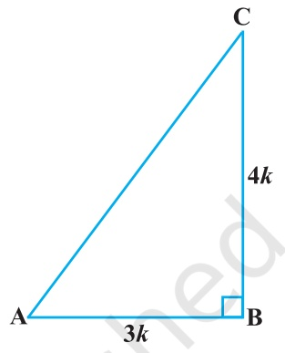
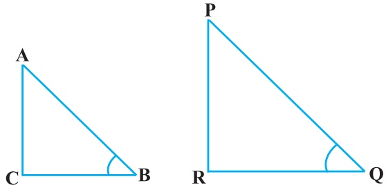

**Remark :** Since the hypotenuse is the longest side in a right triangle, the value of sin A or cos A is always less than 1 (or, in particular, equal to 1).

Let us consider some examples.

**Example 1 :** Given tan $\mathrm { A } = { \frac { 4 } { 3 } }$ , find the other trigonometric ratios of the angle A.

**Solution :** Let us first draw a right   ABC (see Fig 8.8).

Now, we know that tan $\mathrm{A}=\frac{\mathrm{BC}}{\mathrm{AB}}=\frac{4}{3}$

Therefore, if $\mathbf { B } \mathbf { C } = 4 k ,$ then $\mathrm { A B } = 3 k$ , where k is a positive number.

Fig. 8.8

Now, by using the Pythagoras Theorem, we have

$$
AC^{2} = AB^{2} + BC^{2} = (4k)^{2} + (3k)^{2} = 25k^{2}
$$

So,

$$
\mathrm { A C } = 5 k
$$

Now, we can write all the trigonometric ratios using their definitions.

$$
\sin A = \frac{BC}{AC} = \frac{4k}{5k} = \frac{4}{5}
$$

$$
\cos A = \frac{AB}{AC} = \frac{3k}{5k} = \frac{3}{5}
$$

Therefore, cot $\mathrm{A} = \frac{1}{\tan \mathrm{A}} = \frac{3}{4},$ , cosec $\mathrm{A} = \frac{1}{\sin \mathrm{A}} = \frac{5}{4}$ and sec $\mathrm{A} = \frac{1}{\cos \mathrm{A}} = \frac{5}{3}$

**Example 2 :** If $\angle  B and  \angle  Q$ are acute angles such that sin $\mathbf { B } = \sin \mathbf { Q } ,$ then prove that $\angle B = \angle Q$

**Solution :** Let us consider two right triangles ABC and PQR where sin B = sin Q (see Fig. 8.9).

Fig. 8.9

We have

$$
\sin \mathbf { B } = { \frac { \mathrm { A C } } { \mathrm { A B } } }
$$

and

$$
\sin Q = \frac{PR}{PQ}
$$